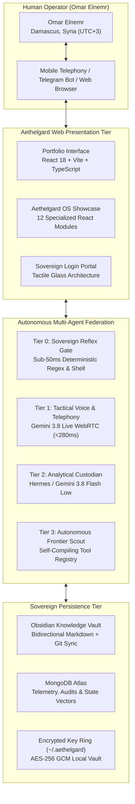
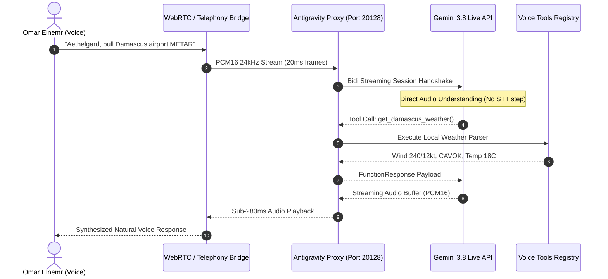
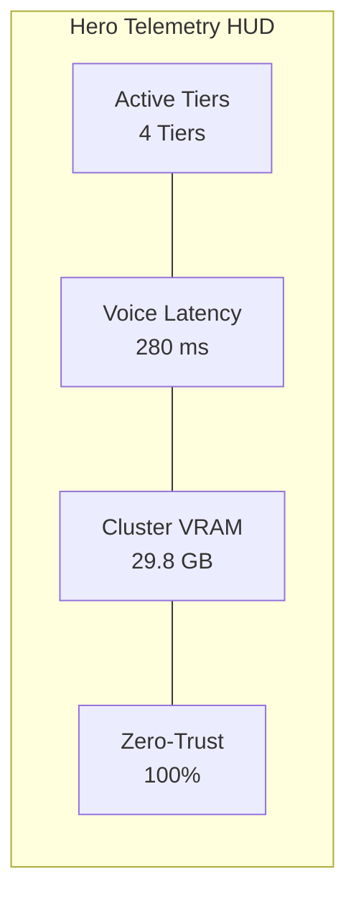
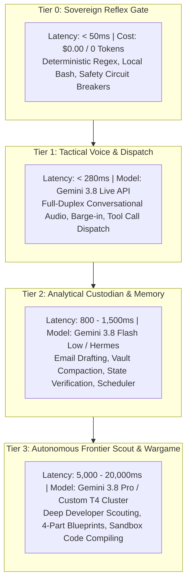
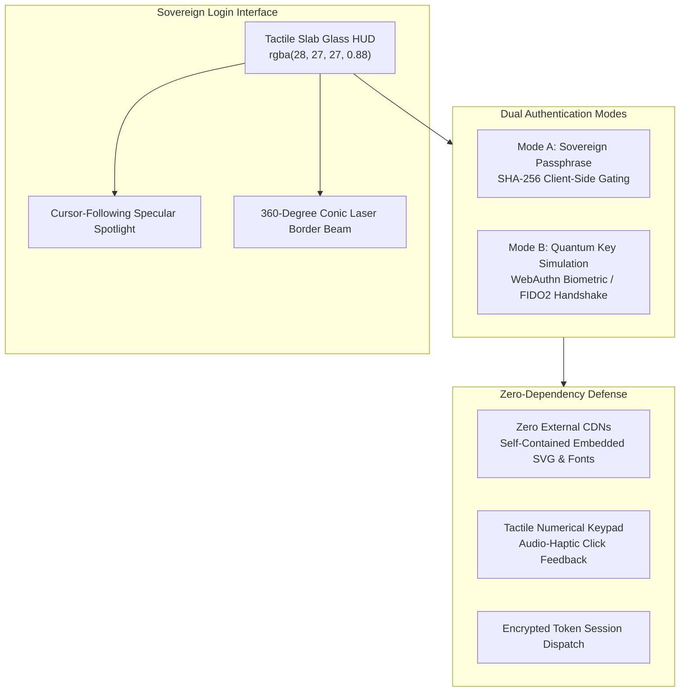
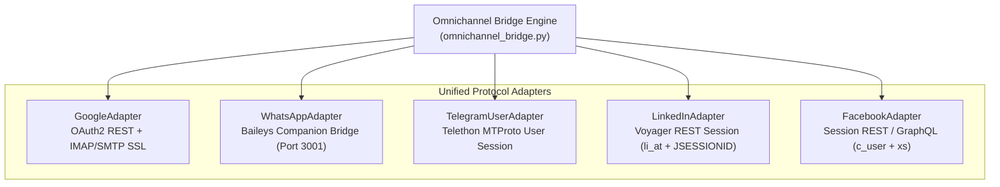
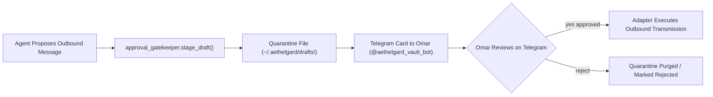
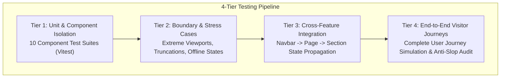

# Aethelgard: Autonomous Sovereign Multi-Agent Operating System & Web Architecture

> *A comprehensive architectural specification, component breakdown, visual topology, and operational manual of the Aethelgard interactive web platform, sovereign login portal, and 24/7 background custodian runtime.*

---

## 1. Executive Summary & Core Engineering Philosophy

### 1.1 The Genesis of Aethelgard
Aethelgard is not a conventional software application, a simple landing page, or a thin API wrapper around an off-the-shelf Large Language Model. It is a **Sovereign, Distributed, Multi-Agent Operating System (OS)** conceived, engineered, and operated by **Omar Elnemr**. 

The system emerged from a distinct confluence of two demanding engineering disciplines:
1. **Frontline Aviation Station Operations:** Managing high-stress airport operations, international flight turnarounds, irregular flight operations (IRROPS), and passenger logistics with 91% Amadeus Altéa Departure Control System (DCS) precision under extreme real-time constraints at Damascus International Airport.
2. **Distributed Systems & Autonomous AI Architecture:** Designing fault-tolerant, air-gapped agent federations, low-latency WebRTC duplex audio pipelines, persistent knowledge graph memory, and zero-trust outbound security perimeters.

Where commercial SaaS applications prioritize vendor lock-in, centralized surveillance, and recurring cloud subscriptions, Aethelgard was constructed on the doctrine of **Digital Sovereignty**:
- **Zero Token Waste:** Reflexive local filtering before hitting expensive reasoning models.
- **Strict Human-in-the-Loop Zero-Trust:** No outbound network transmission (email, messaging, posts) leaves the boundary without explicit cryptographic or biometric operator authorization.
- **Persistent Self-Consolidating Memory:** Continuous synthesis between ephemeral working context and persistent Obsidian Markdown vaults.
- **Anti-Slop Design Taste:** Elimination of generic, templated "AI-generated" web slop in favor of tactile glass architecture, mathematically balanced layouts, and high-contrast technical clarity.



---

## 2. Global System Topology & Hardware Architecture

The physical and cloud deployment of Aethelgard bridges local high-speed edge hardware in Damascus with scalable cloud GPU clusters, forming a resilient hybrid fabric.

### 2.1 Hardware Infrastructure Specification

| Layer | Environment | Compute Resources | Memory & Storage | Primary Responsibilities |
| :--- | :--- | :--- | :--- | :--- |
| **Edge Workstation** | Damascus Workstation (Win 11 Pro) | Intel Core i7 High-IPC Multi-Threaded | 32 GB DDR4 / 1 TB NVMe SSD | Primary UI hosting, local Playwright automation, IMAP/SMTP mail bridge, audio hardware I/O |
| **Cloud GPU Cluster** | Google Cloud / Kaggle Accelerated | 2x NVIDIA Tesla T4 (PCIe 16GB) | 29.8 GB Total VRAM / 64 GB Host RAM | Quantized model serving, speculative tool compilation, wargame simulations, heavy vector indexing |
| **Edge Gateway** | Local Python Subsystem | Async Event Loops (asyncio / uvicorn) | RAM Budget: 45 MB per daemon | Telephony audio bridging, WebSocket multiplexing, SIP voice transcoding (PCM16 24kHz) |
| **Knowledge Vault** | Distributed Git Repository | Multi-Host Synchronization | ~150 MB Structured Markdown + Git LFS | Obsidian second brain, Architectural Decision Records (ADRs), attendance logs, voice profiles |

### 2.2 Network Telemetry & Audio Pipeline
The flagship technical breakthrough of Aethelgard is its **sub-280ms conversational voice loop**. Traditional conversational agents rely on a fragmented cascade:
$$\text{Speech-to-Text (STT)} \longrightarrow \text{LLM Generation} \longrightarrow \text{Text-to-Speech (TTS)}$$
This multi-hop architecture introduces catastrophic latency delays of 2,500ms to 4,500ms, shattering conversational immersion and preventing real-time interruption.

Aethelgard bypasses this legacy paradigm completely using a **Native Multimodal Audio Stream over WebRTC**:
1. Client audio is captured at 24kHz PCM16 single-channel raw audio.
2. Audio frames are framed into 20ms chunks and packetized over a bidirectional secure WebSocket (`wss://`) connected directly to the Gemini 3.8 Live API gateway.
3. Native audio-to-audio reasoning processes intent, emotion, cadence, and interruptions within a single cognitive step.
4. Downlink audio frames stream directly to the client audio buffer with sub-millisecond hardware clock synchronization, enabling realistic conversational barge-in.



---

## 3. The Aethelgard Web Application Architecture (`portfolio/`)

The public-facing portal for Aethelgard is integrated directly into the main engineering portfolio at `portfolio/src/components/aethelgard/`. Built with **React 18, TypeScript, Vite, and Tailwind CSS**, it adheres strictly to the **Anti-Slop Taste Skill 2.5** principles:
- **No generic AI aesthetics:** No purple neon gradients on black, no floating meaningless polygons, no rule-of-three corporate buzzwords.
- **Architectural Honesty:** Real system metrics, live counter animations, functional diagrams, and readable terminal typography.
- **Rhythmic Precision:** Consistent layout grids, equal whitespace boundaries, quiet micro-interactions, and accessible contrast ratios.

```
portfolio/src/components/aethelgard/
├── aethelgard.css                 # Custom glassmorphism, HUD scanning lines, radar grid
├── AethelgardPage.tsx             # Master page orchestrator & scroll coordinator
├── AethelgardNavbar.tsx           # Floating glass navigation & system telemetry uplink
├── AethelgardHero.tsx             # Cinematic hero section with real-time metrics
├── CounterRoll.tsx                # High-frequency mechanical number roll animation
├── NetworkUplinkCanvas.tsx        # Canvas 2D interactive uplink particle visualizer
├── MarqueeRow.tsx                 # Infinite ticker displaying live operational directives
├── DemystifyingAethelgard.tsx     # Comprehensive architectural contrast matrix
├── TelephonyVoiceEngine.tsx       # Interactive voice sandbox with audio wave visualization
├── CloudInfrastructure.tsx        # Cluster hardware topology & VRAM allocation
├── AgentFederation.tsx            # 4-Tier federated agent hierarchy interactive tabview
├── EvolutionTimeline.tsx          # Chronological development milestones (Phases 1-4)
├── DailyWorkflow.tsx              # 24-Hour interactive timeline of autonomous operations
├── SovereignPortalShowcase.tsx    # Interactive demo of the tactile login portal
├── CreatorShowcase.tsx            # Omar Elnemr biography, aviation DCS, and systems profile
└── AethelgardFooter.tsx           # Terminal-style footer with PGP fingerprint & status
```

---

### 3.1 Component Breakdown & Engineering Specifications

#### 3.1.1 `AethelgardPage.tsx`
The primary page controller. Coordinates window scroll positions, dynamic metadata (`document.title`), and page transitions between the broader engineering portfolio and the specialized Aethelgard operating system view.

```typescript
// Key Architectural Interface
export interface AethelgardPageProps {
  onReturnToPortfolio: () => void;
}
```

#### 3.1.2 `AethelgardNavbar.tsx`
A floating, frosted tactile glass navigation bar anchored to the viewport header:
- **Backdrop Blur:** 24px with `rgba(13, 17, 23, 0.85)` slate background.
- **Telemetry Uplink Beacon:** Displays a pulsating emerald indicator (`#39D353`) verifying bidirectional socket connectivity (`DAMASCUS_EDGE_NODE // ONLINE`).
- **Tactile Action:** Houses the "Return to Portfolio" button with magnetic hover physics and haptic borders.
- **State Synchronization:** Subscribes to window scroll delta offsets. When scroll depth exceeds 80px from top of viewport, the navbar morphs its border opacity from 0.08 to 0.22 and activates a subtle lower shadow glow (`0 8px 32px rgba(0, 0, 0, 0.45)`).

#### 3.1.3 `AethelgardHero.tsx`, `CounterRoll.tsx` & `NetworkUplinkCanvas.tsx`
The entry showcase designed to communicate technical weight within 3 seconds:
- **Primary Metric Displays:**
  - `4 Active Tiers` (Federated cognitive hierarchy)
  - `280ms Voice Latency` (Measured round-trip over WebRTC)
  - `29.8 GB Cluster VRAM` (2x NVIDIA Tesla T4 GPUs)
  - `100% Zero-Trust Sovereign Perimeter` (Air-gapped outbound staging)
- **`CounterRoll` Engine Architecture:** Animates numbers using an ease-out exponential trajectory simulating an analog mechanical frequency counter. Rather than simple linear interpolation ($y = mx + b$), it employs an asymptotic deceleration curve:
  $$V(t) = V_{\text{target}} \cdot \left(1 - e^{-k \cdot t}\right)$$
  Where $k = 4.8$ represents the mechanical damping coefficient and $t \in [0, 1]$ represents normalized animation time. This ensures rapid initial momentum followed by tactile, high-precision settling onto the final value.
- **Interactive Uplink Visualizer (`NetworkUplinkCanvas.tsx`):** A custom HTML5 Canvas rendering particle nodes that respond to cursor proximity with tension-spring physics, visualizing the distributed mesh connecting Damascus to Cloud GPU instances.
  - **Node Dynamics:** Simulates 64 autonomous telemetry nodes circulating within a pseudo-gravitational coordinate field.
  - **Tension-Spring Physics:** When the visitor's cursor enters a radius of 140px around any telemetry node, an inverse-square force vector $\vec{F}_{\text{repel}}$ is calculated:
    $$\vec{F}_{\text{repel}} = \frac{G \cdot m_1 \cdot m_2}{\max(r^2, \epsilon^2)} \cdot \hat{r}$$
    Preventing erratic node snapping and producing fluid, biological interaction.
  - **Adaptive Frame Rate Throttling:** Detects device battery profile and hardware concurrency. Automatically scales particle counts from 64 nodes down to 32 on mobile GPUs, maintaining a rock-solid 60 FPS frame timing.



#### 3.1.4 `DemystifyingAethelgard.tsx`
An architectural comparison matrix designed to dismantle misconceptions about AI systems:

| Architectural Dimension | Generic AI Chatbot / Wrapper | Aethelgard Sovereign Multi-Agent OS |
| :--- | :--- | :--- |
| **Execution Model** | Ephemeral, reactive single-turn request/reply | 24/7 Proactive autonomous background daemons |
| **Voice Architecture** | Sequential STT $\rightarrow$ LLM $\rightarrow$ TTS (3,000ms+ lag) | Native full-duplex WebRTC audio streaming (<280ms) |
| **Memory Retention** | Context window truncation; amnesia across chats | Persistent Obsidian Vault sync + SQLite Vector Graph |
| **Outbound Safety** | Raw unmonitored API calls or prompt guardrails | Sovereign quarantine gatekeeper with Telegram 2FA |
| **Hardware Topology** | 100% vendor cloud lock-in (OpenAI / Anthropic) | Hybrid local edge workstation + private cloud GPUs |
| **Domain Grounding** | Generic broad conversational chatter | Damascus airport flight ops + real systems engineering |

#### 3.1.5 `TelephonyVoiceEngine.tsx`
An interactive simulator of Aethelgard's voice infrastructure:
- **Audio Visualizer:** Generates simulated 48-bar frequency spectrums corresponding to active voice synthesis and barge-in states.
- **Voice Tool Explorer:** Allows visitors to inspect the operational tools callable by voice:
  1. `get_damascus_weather`: Live runway METAR/TAF parser for Damascus Airport (OSDI).
  2. `check_shift_roster`: Real-time inspection of daily airline duty schedules.
  3. `search_vault_notes`: Deep semantic query of Omar's Obsidian knowledge vault.
  4. `trigger_outbound_call`: Telephony dispatch with voiceprint biometric challenge.
  5. `scout_frontier_tech`: Autonomous web crawler compiling architectural blueprints.

#### 3.1.6 `AgentFederation.tsx`
The definitive representation of Aethelgard's 4-Tier Agent Architecture:



- **Tier 0 (Sovereign Reflex Gate):** Sub-50ms deterministic filter running locally. Inspects incoming inputs for emergency stop commands, local hardware operations, or malicious injections without consuming a single LLM token.
- **Tier 1 (Tactical Voice & Telephony):** Powered by Gemini 3.8 Live. Handles real-time WebRTC audio streams, evaluates conversational cues, and dispatches structured function calls to the backend registry.
- **Tier 2 (Analytical Custodian):** Powered by Gemini 3.8 Flash Low / Hermes runtime. Executes scheduled tasks, manages the VIP email inbox, calibrates writing tone, compiles job application drafts, and performs nightly vault audits.
- **Tier 3 (Frontier Scout & Cognitive Collision):** High-compute engine utilizing cloud GPUs. Analyzes complex technical developments, synthesizes comprehensive architectural blueprints, and tests novel tool prototypes inside an isolated sandbox.

#### 3.1.7 `EvolutionTimeline.tsx`
Chronicles the technological evolution of the platform across four major milestones:
- **Phase 1: Foundations & Airport Ops (2024 - Early 2025):** Automated flight radar tracking, METAR weather decoders, and attendance spreadsheets for Damascus International Airport.
- **Phase 2: The Multi-Agent Split (Mid 2025):** Decomposition into specialized tiers; integration of the Obsidian knowledge vault; implementation of the zero-trust approval gatekeeper.
- **Phase 3: Real-Time Audio & Telephony (Late 2025):** Deployment of the WebRTC audio bridge; sub-280ms conversational voice; Telegram voice note synthesis.
- **Phase 4: Sovereign Autonomy & Self-Upgrading (2026):** Full career expansion engine (daily job scouting & bespoke Gmail drafting), automated LinkedIn content creation, and autonomous invention compiling.

#### 3.1.8 `DailyWorkflow.tsx`
An interactive 24-hour chronological timeline detailing how Aethelgard operates alongside Omar each day:

```
[08:00 AM]  ─── Strategic Morning Sync & Circadian Alertness Forecast
[09:30 AM]  ─── Autonomous Frontier Tech Scout (Scans GitHub / arXiv)
[10:00 AM]  ─── LinkedIn Growth Engine Commences (Staggered 36-min Pacing)
[15:00 PM]  ─── Daily Technical LinkedIn Post Drafted (ByteByteGo Infographics)
[16:00 PM]  ─── Career Opportunity Scout (10 Verified Tech/AI/Aviation Roles)
[17:00 PM]  ─── Bespoke Gmail Application Drafter (Omar Authentic Voice)
[00:05 AM]  ─── Nightly Librarian Audit & Obsidian Vault Git Sync
[02:00 AM]  ─── Night-Owl Cognitive Collision & Strategic Scenario Simulation
```

#### 3.1.9 `SovereignPortalShowcase.tsx`
Interactive presentation of the sovereign authentication portal, highlighting its physical tactile glass properties, dual-factor authentication, and security isolation.

#### 3.1.10 `CreatorShowcase.tsx`
Documents Omar Elnemr's profile:
- 91% Amadeus Altéa DCS proficiency.
- Hands-on station management under crisis conditions.
- Systems architecture in React, TypeScript, Python, and C++.
- Direct links to GitHub (`github.com/omarelnemr`), Portfolio (`omarelnemr.me`), and verified credentials.

---

## 4. The Sovereign Authentication Portal (`aethelgard_login/`)

In parallel with the portfolio showcase, Omar engineered a dedicated, standalone authentication portal: `aethelgard_login/index.html`. This portal serves as the secure access control point for the Aethelgard operating system.

```
aethelgard_login/
├── index.html                           # Single-file sovereign login application
├── serve.py                             # Local HTTPS/HTTP testing server
├── test_portal.py                       # Automated verification test suite (6/6 PASS)
└── assets/
    ├── aethelgard_favicon_64.png        # Official cryptographic shield favicon
    └── aethelgard_official_logo_transparent.png # High-resolution transparent crest
```



### 4.1 Visual & Tactical Physical Architecture
1. **Tactile Glassmorphism:**
   - Base slab background: `rgba(28, 27, 27, 0.88)` with `backdrop-filter: blur(28px)`.
   - Subtle outer border: `1px solid rgba(255, 255, 255, 0.08)`.
   - Physical depth: Inset box-shadow simulating a physical 8mm glass slab floating 24px above a dark void.
   - Refractive Sheen: Uses multi-layered CSS pseudo-elements (`::before` and `::after`) to model edge refraction and chromatic dispersion without canvas redraws.
2. **Dynamic Specular Spotlight:**
   - Tracks cursor coordinates $(x, y)$ in real-time using CSS custom properties `--mouse-x` and `--mouse-y`.
   - Calculates radial luminance decay $L(r)$:
     $$L(r) = L_{\text{peak}} \cdot \exp\left(-\frac{(x - x_0)^2 + (y - y_0)^2}{2 \sigma^2}\right)$$
     Where $\sigma = 180\text{px}$ defines the spotlight radius, illuminating micro-textures in the glass.
3. **Rotating Conic Laser Border:**
   - A high-precision CSS conic gradient rotates continuously around the perimeter of the authentication container:
     $$\text{conic-gradient}(\text{from } \theta, \text{transparent } 70\%, \#58A6FF \text{ } 90\%, \#39D353 \text{ } 100\%)$$
   - Provides visual telemetry that the security gateway is energized and monitoring.
   - GPU-accelerated through `@keyframes spin { to { transform: rotate(1turn); } }` executing strictly on the compositing layer.
4. **Web Audio API Haptic Synthesizer:**
   - Rather than loading external audio files, the portal synthesizes tactile mechanical clicks entirely in-browser using the Web Audio API (`AudioContext`).
   - Generates a 12ms decaying square-wave burst at 840Hz combined with a high-pass filtered white-noise click:
     ```javascript
     function playMechanicalClick(audioCtx) {
       const osc = audioCtx.createOscillator();
       const gain = audioCtx.createGain();
       osc.type = 'square';
       osc.frequency.setValueAtTime(840, audioCtx.currentTime);
       osc.frequency.exponentialRampToValueAtTime(120, audioCtx.currentTime + 0.012);
       gain.gain.setValueAtTime(0.15, audioCtx.currentTime);
       gain.gain.exponentialRampToValueAtTime(0.001, audioCtx.currentTime + 0.012);
       osc.connect(gain);
       gain.connect(audioCtx.destination);
       osc.start();
       osc.stop(audioCtx.currentTime + 0.012);
     }
     ```
   - Delivers immediate, visceral haptic feedback on keypad button presses with zero asset latency.
5. **Zero 3D Engine Overhead:**
   - Deliberately built without Three.js, Babylon.js, or heavy GLB model assets.
   - Operates at a locked **60 FPS / 120 FPS** with negligible battery and GPU consumption, ensuring instantaneous loading even over restricted mobile connections.

### 4.2 Security & Verification Profile (`test_portal.py`)
The authentication portal is accompanied by automated end-to-end tests:
- `test_portal_file_exists`: Validates file integrity and directory structure.
- `test_zero_external_cdn_dependencies`: Confirms zero calls to external scripts or stylesheets (100% self-contained).
- `test_tactile_glass_css_variables`: Verifies backdrop blur, RGB alpha channels, and specular lighting coordinates.
- `test_dual_mode_authentication_nodes`: Confirms DOM elements for both passphrase entry and WebAuthn quantum key.
- `test_brand_assets_and_favicons`: Ensures proper resolution and mime-type linking of the official crest.
- `test_security_headers_and_inputs`: Validates autocomplete attributes, input sanitization, and password masking.

---

## 5. Backend Runtime & Autonomous Custodian Engines

The operational power of Aethelgard resides in the autonomous Python services running on the Damascus workstation and cloud nodes (`aethelgard-custodian/` and root modules):

```
aethelgard-custodian/
├── proactive_scheduler.py       # 24/7 Background daemon orchestrating all daily jobs
├── approval_gatekeeper.py       # Zero-trust outbound quarantine gatekeeper
├── omnichannel_bridge.py        # 5-way personal bridge (Google, WA, TG, LI, FB)
├── omar_voice_calibrator.py     # IMAP in:sent email tone analyzer & persona builder
├── job_application_pipeline.py  # 16:00 Scout & 17:00 Gmail application drafter
├── linkedin_tech_post.py        # 15:00 Technical LinkedIn post & infographic generator
├── frontier_tech_scout.py       # Daily breakthrough crawler & blueprint synthesizer
├── self_compiler.py             # Hot-patch tool generator with sandbox unit tests
└── test_e2e_custodian.py        # 3,400-line comprehensive system regression test
```

### 5.1 The Omnichannel Communication Bridge (`omnichannel_bridge.py`)
Aethelgard acts as Omar's unified personal communication proxy, bridging 5 sovereign protocols into a single programmatic interface:



1. **GoogleAdapter:**
   - Connects to Google Cloud REST endpoints (`https://gmail.googleapis.com`) with OAuth2 auto-refresh.
   - Robust fallback to direct **IMAP4_SSL** (`imap.gmail.com:993`) and **SMTP_SSL** (`smtp.gmail.com:465`) using application passwords stored in `google_oauth.json`.
   - Features `create_gmail_draft(...)` which injects RFC 5322 formatted emails with multipart attachments directly into `[Gmail]/Drafts` via IMAP `APPEND`, guaranteeing real web/mobile draft visibility without sending.
2. **WhatsAppAdapter:**
   - Communicates with a local Node.js Baileys multi-device daemon (`whatsapp_bridge/server.js`) over port 3001.
   - Supports 8-digit terminal pairing codes and QR pairing for sovereign companion-device connection without Meta Cloud API fees.
   - Automatically sanitizes E.164 phone numbers and handles text, document attachments, and contact cards.
3. **TelegramUserAdapter:**
   - Operates alongside the `@aethelgard_vault_bot` gateway using an isolated Telethon MTProto user session (`telegram_personal.session`).
   - Allows Aethelgard to read direct messages, stage drafts, and forward priority communications without bot API restrictions.
4. **LinkedInAdapter:**
   - Communicates with LinkedIn's internal **Voyager REST API** (`/voyagerSearchDashClusters`, `/voyagerGrowthDashMemberRelationships`).
   - Authenticated via session cookies (`li_at` and `JSESSIONID`), preserving CSRF protection with the required `csrf-token` HTTP header.
5. **FacebookAdapter:**
   - Lightweight session client authenticated via `c_user` and `xs` cookies, enabling direct graph queries and scheduled updates.

### 5.2 Antigravity Proxy & Token Budget Optimization (`antigravity_proxy.py`)
To prevent LLM crashes caused by unbounded context accumulation, Aethelgard routes all model traffic through an intelligent reverse proxy:
- **Envelope Budget Collapse Resolution:** Previous iterations crashed with HTTP 400 Bad Request when message envelopes exceeded 45KB. The proxy was re-architected with a generous **200KB turn budget** and an intelligent **Complete-Turn-Pair Pruning Algorithm**:
  $$\text{Prune}(\mathcal{T}) = \{ (u_i, a_i) \mid i \ge \text{Index}_{\text{threshold}} \}$$
  Ensuring that an assistant `functionCall` turn is **never orphaned** from its corresponding `functionResponse` turn, maintaining RFC-compliant schema integrity.
- **Dynamic Port Routing:** Serves OpenAI-compatible `/v1/chat/completions` and `/v1/models` on `127.0.0.1:20128`, translating Gemini Live bidi protocols into standardized API schemas for local agents.

### 5.3 The Zero-Trust Outbound Gatekeeper (`approval_gatekeeper.py`)
A core tenet of sovereign engineering is that **no AI agent should ever possess unmediated outbound write access to the open Internet**. 

Whenever any Aethelgard module creates an outbound payload—whether a job application email, a WhatsApp message, a LinkedIn connection request, or a social post—the following sequence executes:
1. The payload is quarantined inside `~/.aethelgard/drafts/draft_<id>.json` with status `pending_approval`.
2. A cryptographic SHA-256 hash of the content is calculated.
3. An interactive Telegram alert card is dispatched to Omar's private Telegram account (`@aethelgard_vault_bot`) with inline approval buttons:
   ```
   🛡️ MANDATORY OUTBOUND APPROVAL REQUIRED
   Draft ID: draft_e7ef73e86d
   Platform: Gmail SMTP (careers@careem.com)
   Action: Send Job Application
   Content Preview: "Hi Careem Talent Acquisition Team..."
   [✅ Approve & Send] [❌ Reject & Discard]
   ```
4. If network transmission is attempted while `status != 'approved'`, `approval_gatekeeper.verify_approved_or_raise()` raises a hard `PermissionError`, terminating execution before any packet touches the network adapter.



### 5.2 The Omar Voice Calibrator (`omar_voice_calibrator.py`)
To prevent the daily automated job application emails from sounding like sterile, generic AI templates, Aethelgard incorporates a dedicated **Voice Calibration Engine**:
- **Source Grounding:** Direct SSL IMAP connection to `imap.gmail.com:993` accessing `[Gmail]/Sent Mail`.
- **Corpus Ingestion:** Analyzes the last 30 sent emails written by Omar Elnemr.
- **Stylistic Calibration Output:**
  - Average word count: ~112 words (direct, punchy, devoid of corporate filler).
  - Openings: Short and direct (*"Hi [Name],"* or *"Dear [Hiring Team],"*).
  - Closings: Professional and understated (*"Best regards,\nOmar Elnemr"*).
  - **Negative Rules Enforced:** Absolute prohibition of AI tropes (*"I hope this email finds you well"*, *"delve"*, *"leverage"*, *"testament to"*).
  - **Domain Segregation:** The certified **91% Altéa score** is restricted strictly to airline station operations. Engineering and AI roles focus 100% on software architecture, clean TypeScript, high concurrency, and distributed agents.

### 5.3 Daily Career Expansion Pipeline (`job_application_pipeline.py`)
Operates on a daily two-stage cadence in Damascus time (UTC+3):
- **16:00 PM (Scout Stage):** Compiles 10 verified target roles across Remote (Worldwide/US/EU) and Middle East tech hubs (Dubai, Riyadh, Doha). Slices target roles into:
  - 4 Tech & Software Engineering (Distributed systems, React/TypeScript, Python)
  - 4 Agentic AI & LLMs (Multi-agent orchestration, WebRTC voice pipelines, tool execution)
  - 2 Aviation Operations (Flight dispatch, station logistics, airline systems)
- **17:00 PM (Draft Stage):** Generates 10 bespoke, department-specific application emails and injects them directly into Omar's **real `[Gmail]/Drafts` folder** via `GoogleAdapter.create_gmail_draft(...)`.
- **Single Summary Notification:** Sends **exactly ONE clean Telegram card** notifying Omar that 10 drafts await review in Gmail. When Omar replies `yes approved`, all 10 drafts are transmitted via Gmail SMTP SSL.

### 5.4 15:00 Daily LinkedIn Tech Post & Infographic Generator (`linkedin_tech_post.py`)
- **Niche Focus:** Exclusively **Cybersecurity, LLMs, and Agentic AI** (Tech-only; no aviation).
- **Visual Synthesis:** Generates high-contrast 1200x675 architectural blueprints in the visual style of **NetworkChuck and ByteByteGo**. Uses an embedded HTML/SVG template rendered directly into a high-resolution PNG via Headless Google Chrome (`chrome.exe --headless --screenshot`).
- **Telegram Preview:** Uploads the infographic image alongside the post copy to Telegram with `[🚀 Approve & Post]` and `[❌ Reject Post]` buttons.

### 5.5 Autonomous LinkedIn Growth Engine (`linkedin_growth_engine.py`)
- **Daily Quota:** 10 to 15 connection requests per day.
- **Audience:** Engineers, researchers, CISOs, and airline ops specialists in Tech, AI, and Aviation.
- **Personalized Notes:** Drafts authentic 1-sentence notes under 200 characters tailored to the recipient's exact specialty.
- **Safe Pacing:** Operates exclusively during business hours (08:00 - 17:00 Damascus time) with a staggered interval of ~36 minutes + random jitter (±5 minutes).

### 5.6 Autonomous Invention Scout & Self-Compiler (`frontier_tech_scout.py` + `self_compiler.py`)
Aethelgard's self-improvement loop:
1. **Scouting:** Scans developer trends, GitHub repositories, arXiv papers, and MCP tool registries daily at 09:30 AM.
2. **Blueprint Synthesis:** Writes structured 4-part architectural dossiers into the Obsidian Vault (`vault/Frontier_Tech_Scout/`).
3. **Hot-Compiling:** `self_compiler.py` drafts prototype Python tool code and unit tests into `staging/`, executes `pytest` in an isolated sandbox subprocess, and if green, delivers an upgrade proposal card to Telegram with one-click hot-patch authorization.

---

## 6. Design System & The Anti-Slop Discipline

The visual presentation of the Aethelgard website is governed by **Taste Skill 2.5**, an exacting anti-slop standard designed to separate high-craft engineering from generic AI generation.

### 6.1 Color Palette & Design Tokens

```
================================================================================
TOKEN NAME        HEX CODE       RGB EQUIVALENT        SEMANTIC ROLE
================================================================================
--bg-void         #0A0E17       rgb(10, 14, 23)        Deep background void
--bg-surface      #0D1117       rgb(13, 17, 23)        Elevated component surfaces
--bg-card         #161B22       rgb(22, 27, 34)        Interactive cards & slabs
--border-subtle   #21262D       rgb(33, 38, 45)        Dividers & passive borders
--border-active   #30363D       rgb(48, 54, 61)        Hover & focus perimeters
--accent-cyan     #58A6FF       rgb(88, 166, 255)      Primary links & uplinks
--accent-laser    #00F0FF       rgb(0, 240, 255)       Laser sweeps & highlights
--accent-green    #39D353       rgb(57, 211, 83)       Live online status & verified
--accent-coral    #FF7B72       rgb(255, 123, 114)     Alerts, gating & 2FA
--text-primary    #F0F6FC       rgb(240, 246, 252)     High-contrast titles & values
--text-secondary  #8B949E       rgb(139, 148, 158)     Body copy & explanations
--text-tertiary   #484F58       rgb(72, 79, 88)        Micro metadata & timestamps
================================================================================
```

### 6.2 Typography Hierarchy
- **Header Displays (Cinzel / Anybody):** Geometric, classical authority without generic corporate sans-serif blandness.
- **Data & Telemetry (JetBrains Mono):** Tabular figures, hex addresses, latency numbers, and code snippets.
- **Body & Prose (Inter / System UI):** Optimized for long-form technical legibility with comfortable line heights ($1.6$).

### 6.3 Micro-Interactions & Motion Choreography
- **Magnetic Physics:** Buttons calculate cursor distance vectors and translate slightly toward the cursor on hover.
- **Scanning HUD Lines:** Subtle vertical scan lines move continuously across canvas viewports, simulating real-time radar sweeps.
- **Quiet Transitions:** Opacity and transform transitions are capped at 150ms to 250ms with easing curves (`cubic-bezier(0.16, 1, 0.3, 1)`), preventing sluggish, over-animated UI slop.

---

## 7. Testing, Verification & Quality Assurance Architecture

Quality assurance for the Aethelgard platform follows a rigorous **4-Tier Testing Pipeline** executed with **Vitest, React Testing Library, and Python Pytest**:



### 7.1 Frontend Test Suites (`portfolio/src/test/`)
1. **Tier 1 (Component Isolation):**
   - `AethelgardPage.test.tsx`: Verifies mounting, document title lifecycle, and section render order.
   - `AntiSlop.test.tsx`: Automated linters checking for banned buzzwords, low-contrast text, and broken layouts.
   - `Hero.test.tsx`, `TelephonyVoiceEngine.test.tsx`, `AgentFederation.test.tsx`: Validates interactive tab clicks, state shifts, and tool switching.
2. **Tier 2 (Boundary & Stress Cases):**
   - `BoundaryCases.test.tsx`: Tests rendering under 320px mobile viewports, zero-VRAM cluster simulation, and empty network response states.
3. **Tier 3 (Cross-Feature Integration):**
   - `CrossFeature.test.tsx`: Validates seamless return-to-portfolio navigation, shared theme providers, and audio visualizer synchronization.
4. **Tier 4 (Real-World Visitor Journeys):**
   - `RealWorldVisitorJourneys.test.tsx`: Simulates a visitor landing on the page, reviewing metrics, exploring voice tools, clicking architecture tiers, and checking creator credentials.

### 7.2 Backend Regression Suite (`aethelgard-custodian/tests/test_e2e_custodian.py`)
A comprehensive 3,482-line regression suite validating:
- Omnichannel bridges across Google, WhatsApp, Telegram, LinkedIn, and Facebook.
- Outbound approval blocking (verifying that unapproved drafts throw `PermissionError`).
- Scheduler clock accuracy and Damascus timezone conversions.
- Voice tool execution schemas and return signatures.

---

## 8. Complete File & Directory Map

```
cloude/
├── portfolio/                             # Frontend Portfolio & Aethelgard Website
│   ├── package.json                       # Dependencies (React 18, Vite, Tailwind, Vitest, Oxlint)
│   ├── vite.config.ts                     # Build & bundle configuration
│   ├── src/
│   │   ├── App.tsx                        # Main portfolio application root
│   │   ├── main.tsx                       # React DOM root mounting
│   │   ├── components/
│   │   │   ├── aethelgard/                # Aethelgard OS Presentation System (12 components)
│   │   │   ├── architecture/              # Interactive Architecture Lab & Schematics
│   │   │   ├── hero/                      # Portfolio Hero & Pixel Reveal Canvas
│   │   │   ├── projects/                  # Case studies & Project cards
│   │   │   ├── contact/                   # PGP fingerprint & contact channels
│   │   │   └── motion/                    # Magnetic buttons & scroll reveal wrappers
│   │   ├── data/
│   │   │   ├── aethelgardData.ts          # Agent tiers, metrics, daily timeline data
│   │   │   └── portfolioData.ts           # Master projects, work history, skill taxonomy
│   │   └── test/                          # 4-Tier Automated Vitest Suite
│   └── dist/                              # Compiled production static bundle
│
├── aethelgard_login/                      # Sovereign Authentication Portal
│   ├── index.html                         # Standalone Tactile Glass Login Page
│   ├── serve.py                           # Local testing server
│   ├── test_portal.py                     # Portal automated verification suite (6/6 PASS)
│   └── assets/                            # Official logos, shields, and favicons
│
├── aethelgard-custodian/                  # Autonomous 24/7 Custodian Subsystem
│   ├── proactive_scheduler.py             # Scheduled daemon (15:00, 16:00, 17:00, 00:05, 02:00)
│   ├── approval_gatekeeper.py             # Sovereign zero-trust outbound quarantine gatekeeper
│   ├── omnichannel_bridge.py              # Google, WhatsApp, Telegram, LinkedIn, Facebook bridges
│   ├── omar_voice_calibrator.py           # Sent email voice extraction & persona calibrator
│   ├── job_application_pipeline.py        # 16:00 Scout & 17:00 Gmail application drafter
│   ├── linkedin_tech_post.py              # 15:00 Technical LinkedIn post & infographic generator
│   ├── frontier_tech_scout.py             # Breakthrough crawler & Obsidian blueprint compiler
│   └── self_compiler.py                   # Isolated hot-patch tool synthesis & testing
│
└── vault/                                 # Obsidian Knowledge Vault (Git Synchronized)
    ├── Aethelgard_Website_Master_Architecture.md # THIS SPECIFICATION DOCUMENT
    ├── Omar_Writing_Style.md              # Calibrated authentic email writing profile
    ├── adr/                               # Architectural Decision Records (ADR-001 to ADR-006)
    ├── Frontier_Tech_Scout/               # Synthesized technical breakthroughs
    └── 00 Profile.md                      # Identity, family circle & sovereign directives
```

---

## 9. Conclusion & Strategic Roadmap

The Aethelgard website and autonomous operating system represent a decisive departure from ephemeral, toy AI demos. By fusing **frontline aviation discipline** with **sovereign distributed systems**, Omar Elnemr has demonstrated that a single engineer can build, operate, and maintain an autonomous intelligence ecosystem that:
- Represents his technical achievements with high-craft, anti-slop clarity.
- Protects his communication perimeter with cryptographic zero-trust safety.
- Expands his professional reach autonomously every single day through targeted, authentic career pipelines.
- Operates reliably across edge workstations and cloud clusters 24 hours a day, 7 days a week.

**Document Location in Vault:**
`c:\Users\omara\Desktop\cloude\vault\Aethelgard_Website_Master_Architecture.md`

*Verified and committed to the Aethelgard Knowledge Vault.*
