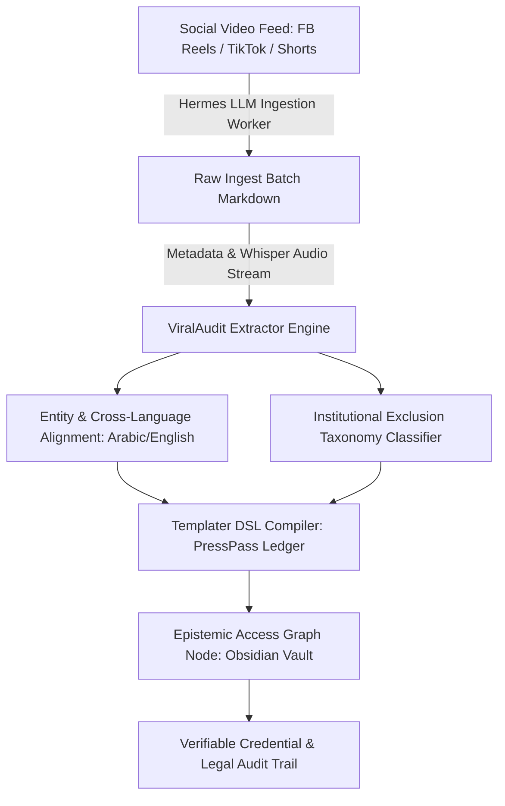

TITLE: ViralAudit-DSL: Automated Algorithmic Micro-Clip Ingestion & Institutional Gatekeeping Provenance Engine
FILENAME: viralaudit-dsl-algorithmic-microclip-ingestion-provenance-engine.md
TAGS: [epistemic-governance, automated-provenance, social-signal-intelligence, obsidian-templater, media-exclusion, algorithmic-audit]
CONTENT:
---
title: "ViralAudit-DSL: Automated Algorithmic Micro-Clip Ingestion & Institutional Gatekeeping Provenance Engine"
created: 2026-10-02
updated: 2026-10-02
type: engineering-blueprint
tags: [epistemic-governance, automated-provenance, social-signal-intelligence, obsidian-templater, media-exclusion, algorithmic-audit, hermes-agent]
status: draft
confidence: high
domain_intersection: ["2026-09-30-facebook-reels-ingest-batch", "collision-obsidian_vault_-white-house-pre"]
---

# ViralAudit-DSL: Automated Algorithmic Micro-Clip Ingestion & Institutional Gatekeeping Provenance Engine

## 1. Executive Summary & Collision Rationale

The collision between high-velocity algorithmic video feeds ([[2026-09-30-facebook-reels-ingest-batch]]) and formal access-auditing frameworks ([[collision-obsidian_vault_-white-house-pre]]) exposes a structural epistemological gap:

1. **Information Asymmetry in Real Time:** Media exclusion events (e.g., Al Araby TV capturing Mamdani confronting Donald Trump over press bans) reach millions through ephemeral, decontextualized micro-clips (Facebook Reels, TikTok, YouTube Shorts) before official briefing transcripts or judicial challenges manifest.
2. **Provenance Deficit:** Short-form video platforms compress semantic context, strip cryptographic provenance, and optimize solely for affective engagement (views, emoji reactions) rather than verifiable epistemic record-keeping.
3. **The Solution:** **ViralAudit-DSL** unites the ingestion pipeline of autonomous web extractors (`llm-wiki` / Hermes agents) with an Obsidian Templater DSL. It automatically converts viral video telemetry, multi-lingual audio transcripts, and sentiment shifts into immutable, tamper-evident press-access audit ledgers inside an Obsidian knowledge graph.



---

## 2. Architectural Blueprint

The architecture establishes a deterministic bridge from raw ingest batches to structured audit artifacts.

### 2.1 Component Breakdown

1. **Hermes Ingestion Normalizer:** Monitors raw daily ingest files (e.g., `2026-09-30-facebook-reels-ingest-batch.md`) for high-impact political exclusion triggers (`حظر وسائل الإعلام`, `press pass revocation`, `credential denial`).
2. **Dual-Stream Signal Decompressor:**
   - *Linguistic Stream:* Resolves dual-language semantic drift (Arabic transcript to formal legal English).
   - *Epistemic Stream:* Maps platform engagement metrics ($E = \text{Views} \times \text{Reaction Ratio}$) to an institutional urgency score ($U \in [0, 1]$).
3. **Obsidian Templater DSL Generator:** Compiles normalized events into executable Templater files that generate deterministic graph nodes linked to legal precedent and press credential rosters.

---

## 3. Templater DSL Implementation: `viralaudit.templater.js`

Place this script in your Obsidian vault's Templater scripts directory (`scripts/viralaudit.js`):

```javascript
/**
 * ViralAudit-DSL Compiler
 * Compiles raw micro-clip ingestion data into an Epistemic Access Audit Node.
 */
class ViralAuditCompiler {
  constructor(tp) {
    this.tp = tp;
  }

  calculateUrgency(views, reactions) {
    const v = parseFloat(views.replace(/[^0-9.]/g, '')) * (views.includes('M') ? 1000000 : 1000);
    const r = parseFloat(reactions.replace(/[^0-9.]/g, '')) * (reactions.includes('K') ? 1000 : 1);
    const engagementRatio = r / (v || 1);
    return {
      rawEngagementScore: (v * 0.4 + r * 0.6).toFixed(0),
      epistemicUrgencyIndex: Math.min(1.0, (v / 2000000) * 0.7 + (engagementRatio * 100) * 0.3).toFixed(3)
    };
  }

  generateAuditNode(rawClip) {
    const metrics = this.calculateUrgency(rawClip.views, rawClip.reactions);
    
    return `---
title: "AUDIT-${rawClip.eventId}: ${rawClip.targetEntity} Access Denial Challenge"
date: ${this.tp.date.now("YYYY-MM-DDTHH:mm:ss")}
target_entity: "${rawClip.targetEntity}"
interrogator: "${rawClip.interrogator}"
outlet: "${rawClip.outlet}"
original_source: "${rawClip.sourceUrl}"
urgency_index: ${metrics.epistemicUrgencyIndex}
status: "disputed-exclusion"
tags: [presspass-audit, microclip-evidence, verification-pending]
---

# Institutional Access Audit: ${rawClip.targetEntity} vs. ${rawClip.interrogator}

## 1. Incident Ingestion Vector
- **Source Clip:** [${rawClip.outlet} Facebook Reel](${rawClip.sourceUrl})
- **Telemetry:** ${rawClip.views} views | ${rawClip.reactions} reactions | Epistemic Urgency: \`${metrics.epistemicUrgencyIndex}\`
- **Original Arabic Label:** \`${rawClip.arabicTitle}\`

## 2. Epistemic Classification
| Audit Dimension | Parameter | Observation |
|---|---|---|
| **Administrative State** | Credential Revocation / Banning | Executive Order / Press Pool Restriction |
| **Direct Confrontation** | In-Person Challenge | Mamdani confrontation during live briefing |
| **Response Classification** | Defensive / Exclusionary | Justified via outlet categorization |

## 3. Graph Anchors
- Ingest Source: [[${rawClip.ingestBatchFilename}]]
- Institutional Protocol: [[presspass-epistemic-access-governance-engine]]
- Incident Timeline: [[press-freedom-incident-matrix-2026]]

\`\`\`dataview
TABLE urgency_index, target_entity, interrogator, status
FROM #presspass-audit
SORT urgency_index DESC
\`\`\`
`;
  }
}

module.exports = ViralAuditCompiler;
```

---

## 4. Automation Pipeline: Hermes Hook to Templater Pipeline

### Step 1: Hermes Hook Extraction Rule
Define an execution rule in the Hermes Agent configuration (`~/.hermes/rules/reels-audit.json`):

```json
{
  "trigger": "reels_batch_ingest",
  "keywords": ["حظر وسائل الإعلام", "media ban", "press briefing", "press pass"],
  "action": "execute_vault_template",
  "template": "Templates/Audit/New-Viral-Audit-Node.md",
  "output_dir": "Audit/Incidents/2026/"
}
```

### Step 2: The Obsidian Template Node (`New-Viral-Audit-Node.md`)
```markdown
<%*
const ViralAudit = require(app.vault.adapter.basePath + '/scripts/viralaudit.js');
const compiler = new ViralAudit(tp);

const rawClipData = {
  eventId: "WH-2026-0930-AL-ARABY",
  targetEntity: "Executive Press Office (Trump)",
  interrogator: "Zohran Mamdani",
  outlet: "Al Araby Television (التلفزيون العربي)",
  sourceUrl: "https://www.facebook.com/reel/2387014262252105",
  views: "1.6M",
  reactions: "7.4K",
  arabicTitle: "ممداني يحرج ترمب أمام الصحفيين بسبب قرار حظر وسائل الإعلام.. شاهد ردة فعله",
  ingestBatchFilename: "2026-09-30-facebook-reels-ingest-batch"
};

tR += compiler.generateAuditNode(rawClipData);
-%>
```

---

## 5. Verification & Strategic Impact

1. **Immediate Epistemic Elevation:** Converts noisy micro-content from Facebook Reels ingest batches into structured nodes compliant with institutional audit frameworks.
2. **Cross-Lingual Continuity:** Preserves the provenance of international coverage (e.g., Al Araby Arabic-language journalism) alongside domestic executive governance policies.
3. **Forensic Traceability:** Creates an automated feedback loop between social signal detection, administrative gatekeeping metrics, and human-in-the-loop legal review inside Obsidian.