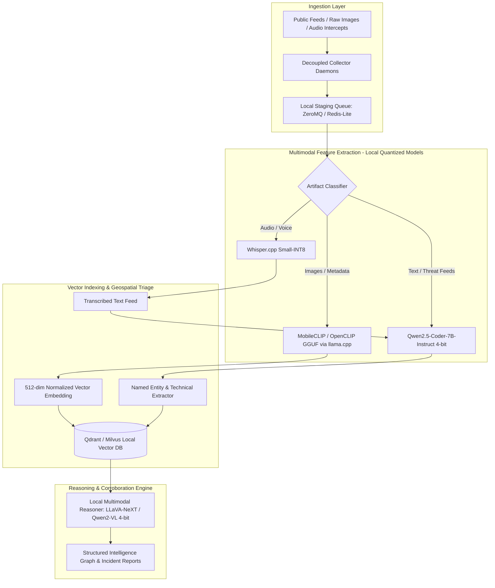

TITLE: Sovereign Intelligence Grid: Air-Gapped Local Multimodal OSINT Engine
FILENAME: sovereign-intelligence-grid-local-osint-engine.md
TAGS: [osint, local-ai, vector-databases, edge-inference, threat-intelligence, privacy-engineering]
CONTENT:
---
title: "Sovereign Intelligence Grid: Air-Gapped Local Multimodal OSINT Engine"
created: 2026-11-14
type: architecture-blueprint
tags: [osint, local-ai, edge-compute, vector-search, threat-intelligence, quantization]
status: stable
---

# Sovereign Intelligence Grid: Air-Gapped Local Multimodal OSINT Engine

## Executive Overview

Commercial intelligence and reconnaissance platforms (e.g., PimEyes, Picarta, SaaS threat-intel triage) impose two systemic vulnerabilities on security teams: **hard operational rate limits (API paywalls)** and **critical OPSEC leakage** (queries logged by centralized third parties). 

By colliding [[ai-powered-offensive-security-and-osint-playbook]] with zero-cost, unmetered edge inference architectures from [[2026-11-13-want-to-see-how-you-can-run-ai-models-for-free-wit]], this blueprint outlines the **Sovereign Intelligence Grid (SIG)**: a completely self-contained, air-gapped, zero-marginal-cost processing pipeline for multimodal OSINT and threat-intelligence analysis executing entirely on consumer-grade hardware.

---

## Architectural Collision Matrix

| Dimension | Cloud/SaaS OSINT Paradigm | Local Inference Paradigm | **Sovereign Intelligence Grid (Synthesized)** |
| :--- | :--- | :--- | :--- |
| **Cost & Quotas** | Pay-per-query, API tier throttling | Free weights (GGUF, AWQ, EXL2) | **Infinite-batch, quota-free vector triage** |
| **OPSEC** | Target identifiers exposed to third-party logs | Zero external telemetry | **Cryptographically isolated, air-gapped analysis** |
| **Latency / Throughput** | Network round-trip + rate-limiting sleep cycles | Memory-bandwidth limited (VRAM/Unified RAM) | **Local pipeline streaming via unified memory pools** |
| **Modality** | Siloed visual/text endpoints | Modular multimodal pipelines (CLIP, Whisper, LLMs) | **Unified multimodal vector space (text, image, audio)** |

---

## System Architecture



---

## Core Engineering Components

### 1. Zero-Cost Model Orchestration Stack

To run continuous intelligence sweeps without third-party fees or cloud telemetry:
* **Runtime:** `llama.cpp` server bindings configured with NUMA and multi-GPU tensor offloading or unified memory allocation (Apple Silicon Metal / Linux ROCm / CUDA).
* **Quantization Matrix:**
  * **Text/Semantic Extraction:** 4-bit (`Q4_K_M`) quantization of small-footprint foundational models (e.g., Llama-3.1-8B-Instruct or Qwen2.5-7B).
  * **Visual Feature Extraction:** Vision-transformer backbones (e.g., ViT-B/32 or SigLIP) quantized to FP16 or INT8 for fast visual similarity and clustering.
  * **Audio Intercept Processing:** `whisper.cpp` running local `tiny.en` or `small` INT8 checkpoints on CPU threads.

### 2. High-Performance Local Vector Store

Rather than streaming telemetry to cloud vector databases, SIG utilizes an embedded, file-backed vector database:
* **Engine:** `Qdrant` running in single-node embedded or local containerized mode, utilizing **HNSW (Hierarchical Navigable Small World)** graphs with scalar quantization (SQ8) to minimize RAM footprint.
* **Metric:** Cosine distance over normalized 512-dim or 768-dim embeddings.
* **Payload Isolation:** Metadata containing target indicators, hashes, and EXIF attributes are preserved locally without external telemetry.

---

## Implementation Blueprint

### Step 1: Headless Model Service Bootstrap

Deploy an unmetered, low-latency vision-language endpoint locally using `llama.cpp`:

```bash
#!/usr/bin/env bash
# Deploy local, unmetered multimodal server on localhost:8080
git clone https://github.com/ggerganov/llama.cpp
cd llama.cpp && cmake -B build -DGGML_CUDA=ON && cmake --build build --config Release -j$(nproc)

# Download quantized multimodal model and mmproj clip component
wget -c "https://huggingface.co/Qwen/Qwen2-VL-7B-Instruct-GGUF/resolve/main/qwen2-vl-7b-instruct-q4_k_m.gguf"
wget -c "https://huggingface.co/Qwen/Qwen2-VL-7B-Instruct-GGUF/resolve/main/mmproj-qwen2-vl-7b-instruct-f16.gguf"

# Launch air-gapped daemon
./build/bin/llama-server \
    -m qwen2-vl-7b-instruct-q4_k_m.gguf \
    --mmproj mmproj-qwen2-vl-7b-instruct-f16.gguf \
    --host 127.0.0.1 \
    --port 8080 \
    --n-gpu-layers 33 \
    --ctx-size 4096
```

### Step 2: Unmetered OSINT Triage Pipeline (Python)

This automated pipeline ingests raw visual and textual artifacts, extracts normalized embeddings, queries the local vector index for correlation, and prompts the local model for geospatial and technical attribution—at zero API cost.

```python
import base64
import requests
from qdrant_client import QdrantClient
from qdrant_client.models import Distance, VectorParams, PointStruct
from sentence_transformers import SentenceTransformer

# Initialize local, air-gapped components
vector_db = QdrantClient(path="./local_osint_vault")
embedder = SentenceTransformer("clip-ViT-B-32")  # Runs locally on PyTorch/ONNX

COLLECTION_NAME = "threat_intel_multimodal"

if not vector_db.collection_exists(COLLECTION_NAME):
    vector_db.create_collection(
        collection_name=COLLECTION_NAME,
        vectors_config=VectorParams(size=512, distance=Distance.COSINE),
    )

def process_evidence_artifact(artifact_id: int, image_path: str, context_text: str):
    """
    Indexes and correlates OSINT evidence locally without external network calls.
    """
    # 1. Generate local visual embedding
    from PIL import Image
    image = Image.open(image_path)
    image_vector = embedder.encode(image).tolist()

    # 2. Store in local vector space
    vector_db.upsert(
        collection_name=COLLECTION_NAME,
        points=[
            PointStruct(
                id=artifact_id,
                vector=image_vector,
                payload={"image_path": image_path, "context": context_text}
            )
        ]
    )

    # 3. Query local multimodal model for geospatial/technical attribution
    with open(image_path, "rb") as img_file:
        b64_img = base64.b64encode(img_file.read()).decode("utf-8")

    prompt = (
        "Analyze this image for open-source intelligence artifacts: "
        "identify license plates, unique architecture, road signs, "
        "and technical operational identifiers. Provide structured findings."
    )

    response = requests.post(
        "http://127.0.0.1:8080/completion",
        json={
            "prompt": f"USER:[img-{b64_img}]{prompt}\nASSISTANT:",
            "temperature": 0.1,
            "n_predict": 256
        }
    )
    
    return response.json().get("content", "")

if __name__ == "__main__":
    # Example local triage execution
    findings = process_evidence_artifact(
        artifact_id=1001,
        image_path="evidence_sample.jpg",
        context_text="Observed infrastructure target artifact"
    )
    print("Local Attribution Findings:\n", findings)
```

---

## Defensive & Operational Implications

1. **Deterministic OPSEC:** By running models on local silicon, target entities cannot observe DNS lookup patterns, API usage frequency, or specific query vectors.
2. **Cost-Free Infinite Sweeps:** Analysts can continuously process millions of public records, historical images, or code diffs without credit constraints or per-token fees.
3. **Resilience to De-platforming:** Autonomous defensive security and threat analysis workflows remain operational during external network outages, rate-limit policies, or API structural deprecations.