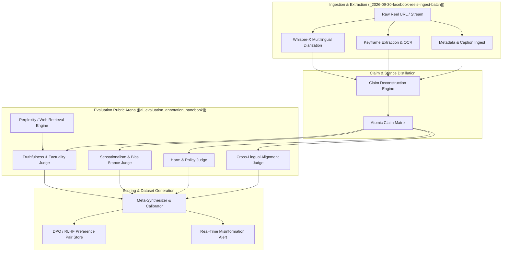

TITLE: Multi-Modal Reel Truthfulness & Bias Verification Harness (MM-TBVH)
FILENAME: multi-modal-reel-truthfulness-and-bias-verification-harness.md
TAGS: [rlhf, ai-evaluation, automated-fact-checking, video-ingest, multimodality, nlp]
CONTENT:
---
aliases: [MM-TBVH, Video Fact-Checking Pipeline, Reel RLHF Evaluation Harness]
tags: [rlhf, ai-evaluation, automated-fact-checking, video-ingest, multimodality, nlp]
created: 2026-10-01
up: "[[ai_evaluation_annotation_handbook]]"
related: ["[[2026-09-30-facebook-reels-ingest-batch]]", "[[Work/Experience_and_Roles]]"]
---

# Multi-Modal Reel Truthfulness & Bias Verification Harness (MM-TBVH)

The **Multi-Modal Reel Truthfulness & Bias Verification Harness (MM-TBVH)** cross-pollinates standardized human-in-the-loop (HITL) RLHF evaluation rubrics from [[ai_evaluation_annotation_handbook]] with high-velocity, multilingual social video streams from [[2026-09-30-facebook-reels-ingest-batch]].

Short-form video feeds (e.g., Facebook Reels, TikTok) introduce unique challenges to evaluation: non-linear context, clickbait framing ("شاهد ردة فعله" / "watch his reaction"), multi-lingual speech transcription artifacts, and visual-audio grounding divergence. MM-TBVH turns raw social ingestion into an automated, multi-agent evaluation pipeline that scores content against professional RLHF rubric dimensions: **Truthfulness & Factuality**, **Sensationalism & Clickbait Drift**, **Harmlessness/Toxicity**, and **Cross-Lingual Attribution Integrity**.

---

## 1. Architectural Blueprint

The architecture establishes a multi-stage pipeline where raw video metadata and audio-visual streams are ingested, transcribed, and synthesized into grounded claims. These claims are evaluated by specialized agentic judges calibrated to align with commercial annotation rubrics (Alignerr / Outlier style).



---

## 2. Core Evaluation Rubrics for Short-Form Video

Translating static prompt rubrics into video dynamic metrics:

| Dimension | Prompt Rubric Standard | Video / Reel Adaptation | Verification Method |
| :--- | :--- | :--- | :--- |
| **Truthfulness & Factuality** | Grounded against verifiable consensus facts; zero hallucinations. | Did the event depicted (e.g., White House press briefing) actually happen in the stated context, or is it recycled archival footage? | Retrieval-augmented verification against wire services (AP, Reuters) using temporal keyframe and transcript hashing. |
| **Instruction / Stance Fidelity** | Strict adherence to constraints and input semantics. | Headline Clickbait Drift: Does the Arabic/English caption ("ممداني يحرج ترمب") accurately reflect the actual verbal interaction in the video? | Stance detection comparing video transcript polarity to caption polarity. |
| **Harmlessness & Safety** | Zero tolerance for dangerous activities, hate speech, or targeted harassment. | Detection of edited cuts intending to incite violence, defamatory framing, or out-of-context harassment. | Multi-modal toxic span identification across speech and visual overlays. |
| **Cross-Lingual Equivalence** | Consistent meaning preservation across source and target languages. | Verifying that the target translation (e.g., English) does not systematically escalate or soften sentiment compared to source Arabic audio. | Bidirectional semantic preservation scoring (ChrF++ and semantic embedding delta). |

---

## 3. Concrete Implementation Steps

### Step 1: Atomic Claim Extraction Schema (Pydantic)

```python
from pydantic import BaseModel, Field
from typing import List, Optional

class AtomicClaim(BaseModel):
    claim_id: str
    claim_text: str
    temporal_start_sec: float
    temporal_end_sec: float
    modality_source: str = Field(description="audio, visual_ocr, or caption")
    original_language: str
    translated_text_en: Optional[str] = None

class ReelVerificationReport(BaseModel):
    reel_id: str
    source_url: str
    overall_truthfulness_score: float = Field(ge=0.0, le=5.0)
    clickbait_drift_score: float = Field(ge=0.0, le=1.0, description="0=accurate, 1=pure clickbait")
    claims: List[AtomicClaim]
    discrepancy_analysis: str
    is_safe: bool
```

### Step 2: Multi-Agent Calibration Prompts

The system spins up specialized sub-agents parameterized with standard RLHF instructions:

```python
JUDGE_SYSTEM_PROMPT = """You are a Principal AI Annotation Specialist operating under strict RLHF guidelines.
Your objective is to evaluate short-form social video transcriptions against retrieved factual evidence.

Evaluate along four criteria:
1. FACTUALITY (1-5): Penalize heavily for decontextualized footage presented as breaking news.
2. SENSATIONALISM DRIFT (0-1): Measure the delta between what the caption promises ('Mamdani embarrasses Trump') vs. what transcript shows.
3. TRANSLATION ACCURACY (1-5): Ensure cultural idioms and cross-lingual nuances in Arabic-English translation are preserved without bias injection.
4. SAFETY: Flag defamatory, coordinated inauthentic behavior, or violated privacy.

Format output as strict JSON compliant with the ReelVerificationReport schema."""
```

### Step 3: RLHF Dataset Ingestion Pipeline

1. **Intake**: Pull ingested records from daily digests like `[[2026-09-30-facebook-reels-ingest-batch]]`.
2. **Deconstruction**: Run speech-to-text with timestamping via Whisper-X, extract on-screen OCR text.
3. **Execution Verification**: Fire tool calls against search engines for event temporal corroboration (verifying date, attendees, and actual statements).
4. **Preference Dataset Assembly**:
   - **Chosen Response**: A neutral, factual, highly-grounded contextual summary of the video interaction.
   - **Rejected Response**: The original sensationalized caption with unverified claims and emotional hyperbole.
   - Write to an open format (e.g., Hugging Face `datasets` / JSONL) for fine-tuning DPO/RLHF reward models on real-world multi-modal news interpretation.

---

## 4. Next Actions & Integration

- [ ] Connect Hermes LLM Wiki Agent ingest hooks (`llm-wiki`) directly to MM-TBVH pipeline.
- [ ] Implement automated generation of DPO reward pairs from high-engagement Reels.
- [ ] Add calibrated confidence thresholds to trigger human annotator intervention on ambiguous political content.