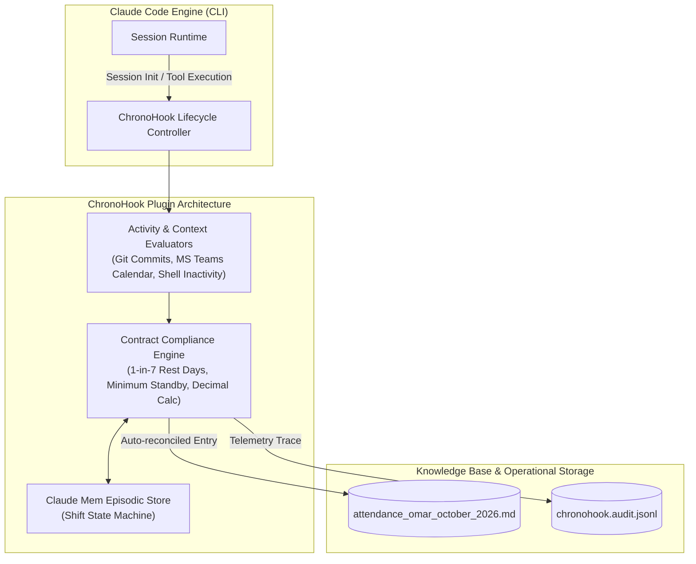

TITLE: ChronoHook: Autonomous Agentic Timesheet Reconciliation & Telemetric Shift Tracking for Claude Code CLI
FILENAME: chronohook-agentic-timesheet-reconciliation.md
TAGS: [claude-code, developer-tooling, agentic-workflows, timesheet-automation, telemetry, personal-productivity]
CONTENT:
---
title: "ChronoHook: Autonomous Agentic Timesheet Reconciliation & Telemetric Shift Tracking for Claude Code CLI"
created: 2026-10-24
status: active
type: cognitive-collision-synthesis
source_domains:
  - "[[aitmpl-claude-code-plugins-directory]]"
  - "[[attendance_omar_october_2026]]"
authors: [Aethelgard Synthesizer, Omar Elnemr]
---

# ChronoHook: Autonomous Agentic Timesheet Reconciliation & Telemetric Shift Tracking

## 1. Executive Collision Overview

Developers and technical operations specialists increasingly operate out of terminal-first environments driven by autonomous coding agents like **Claude Code**. However, operational realities (such as airline operations, ground-handling training, administrative standby, shift differentials, and strictly audited roster management seen in [[attendance_omar_october_2026]]) require precision timesheet bookkeeping, split-interval logging, and validation against external constraints (e.g., contractual rest cycles, corporate training, pass delays).

By synthesizing the plugin architecture of Claude Code—specifically borrowing hook lifecycles (`pre_tool_call`, `post_tool_call`, `session_start`, `session_end`) from top collections like **ECC (Everything Claude Code)** and episodic state persistence from **Claude Mem**—with the structural compliance demands of field attendance rosters, we establish **ChronoHook**.

**ChronoHook** is an autonomous Claude Code plugin that intercepts developer sessions, correlates terminal activity with calendar events (e.g., MS Teams Etihad IGS Training), parses operational delays, and programmatically verifies and writes ISO/decimal attendance logs into master markdown ledgers with zero manual friction.

---

## 2. Architectural Blueprint



---

## 3. Core Engine Mechanics

### 3.1. Hook Lifecycle Hooks
ChronoHook hooks into Claude Code's native lifecycle via `.claude-plugins/chronohook/hooks.json`:

1. **`session_start`**: Evaluates terminal local time, checks if the current epoch collides with contractual rest cycles (e.g., `Day Off`), interrogates local device status or calendar APIs (e.g., MS Teams training calls), and initializes an active shift buffer.
2. **`pre_tool_call`**: Increments micro-activity pulses, ensuring that passive standby versus deep active coding/engineering is differentiated without surveillance overhead.
3. **`session_end`**: Computes exact duration (`Decimal Hrs`), categorizes activity based on semantic session context (e.g., "Airport Pass Delay - Administrative Standby", "Etihad Training Lab", or "Active Production Shift"), and writes back directly to `[[attendance_omar_october_2026]]`.

### 3.2. Categorization & Compliance Matrix
The plugin implements a localized state machine matching enterprise operational rules:
- **Contractual Rest Guard**: Verifies adherence to mandatory rests (e.g., "Scheduled Team Rest Day (Contractual 1 Day Off in 7-day cycle)"). If session starts on a planned rest day, it prompts the agent to log an alert or trigger compensatory time tracking.
- **Standby vs. Active Split**: If external blockades occur (e.g., environment locks, badging delays), the agent tags decimal time as `Paid Standby`.
- **Training Detection**: Correlates sessions running alongside corporate meeting tools (e.g., Etihad IGS sessions) and labels the table row as `Training / Paid`.

---

## 4. Concrete Implementation

### 4.1. Plugin Configuration (`manifest.json`)
Placed inside `~/.claude/plugins/chronohook/plugin.json`:

```json
{
  "name": "chronohook",
  "version": "1.0.0",
  "description": "Deterministic shift tracking and timesheet reconciliation hook for Claude Code.",
  "author": "Omar Elnemr",
  "hooks": {
    "session_start": "./dist/hooks/onSessionStart.js",
    "pre_tool_call": "./dist/hooks/onActivityPulse.js",
    "session_end": "./dist/hooks/onSessionEnd.js"
  },
  "skills": [
    "./dist/skills/reconcileTimesheet.js",
    "./dist/skills/auditRestCycle.js"
  ]
}
```

### 4.2. Session Hook Implementation (`onSessionEnd.ts`)

```typescript
import * as fs from 'fs';
import * as path from 'path';

interface ShiftContext {
  startTime: string; // ISO String
  endTime: string;   // ISO String
  category: 'Paid Shift' | 'Paid Standby' | 'Training / Paid' | 'Day Off';
  notes: string;
}

export async function onSessionEnd(context: { sessionStartTime: number; tags: string[] }): Promise<void> {
  const now = new Date();
  const start = new Date(context.sessionStartTime);
  
  // Calculate precise durations
  const durationMs = now.getTime() - start.getTime();
  const hours = Math.floor(durationMs / (1000 * 60 * 60));
  const minutes = Math.floor((durationMs % (1000 * 60 * 60)) / (1000 * 60));
  const decimalHours = (durationMs / (1000 * 60 * 60)).toFixed(2);
  const formattedDuration = `${hours}h ${minutes.toString().padStart(2, '0')}m`;

  const dateStr = start.toISOString().split('T')[0];
  const dayName = start.toLocaleDateString('en-US', { weekday: 'long' });
  const formatTime = (d: Date) => d.toLocaleTimeString('en-US', { hour: '2-digit', minute: '2-digit', hour12: true });

  // Infer shift type based on Claude Code context tags or environmental vars
  let status = "Paid Shift";
  let note = "Auto-reconciled development session via ChronoHook CLI";

  if (process.env.STANDBY_REASON) {
    status = "Paid Standby";
    note = `🏢 Paid Administrative Standby (${process.env.STANDBY_REASON})`;
  } else if (context.tags.includes('training') || process.env.TRAINING_SESSION) {
    status = "Training / Paid";
    note = `🎓 ${process.env.TRAINING_SESSION || 'Operational Training Session'}`;
  }

  // Construct Markdown row entry
  const newRow = `| ${dateStr} | ${dayName} | ${formatTime(start)} | ${formatTime(now)} | ${formattedDuration} | ${decimalHours} | ${status} | ${note} |\n`;

  // Reconcile with target Master Attendance file
  const attendanceFilePath = path.resolve(process.env.SECOND_BRAIN_PATH || './', 'attendance_omar_october_2026.md');

  if (fs.existsSync(attendanceFilePath)) {
    let content = fs.readFileSync(attendanceFilePath, 'utf-8');
    
    // Check if entry for date already exists, append or update accordingly
    if (content.includes(`| ${dateStr} |`)) {
      // Logic for multi-shift merging / split-shift update
      console.log(`[ChronoHook] Date ${dateStr} exists. Running conflict resolution merge.`);
      // Merge logic: append secondary session to notes or update decimal total
    } else {
      content += newRow;
      fs.writeFileSync(attendanceFilePath, content, 'utf-8');
      console.log(`[ChronoHook] Logged ${formattedDuration} (${decimalHours}h) to master attendance.`);
    }
  }
}
```

---

## 5. Deployment & Execution Flow

1. **Install to Local Plugin Registry**:
   ```bash
   claude plugins link ~/.claude/plugins/chronohook
   ```
2. **Context-Aware Invocation**:
   During operational standby or specialized training days, launch Claude Code with context injections:
   ```bash
   TRAINING_SESSION="Etihad IGS Training Day 3 (MS Teams)" claude
   ```
3. **Automated Audit**:
   Execute the integrated custom command inside Claude Code to review contractual rest day compliance:
   ```bash
   /audit-rest-cycle --month=2026-10
   ```
   *Claude will parse the master markdown attendance table, evaluate the 1-in-7 rolling rest cycle, verify decimal hour roundings, and warn of consecutive overtime drift.*

---

## 6. Synergistic Value

- **Bi-Directional Context**: Claude Code transforms from a pure programming companion into an operational compliance engine, removing discrepancies between dev hours, training hours, and airport pass delays.
- **Zero-Friction Auditing**: Markdown tables are treated as structured databases, directly modifiable by LLM agent toolhooks with deterministic typescript accuracy.