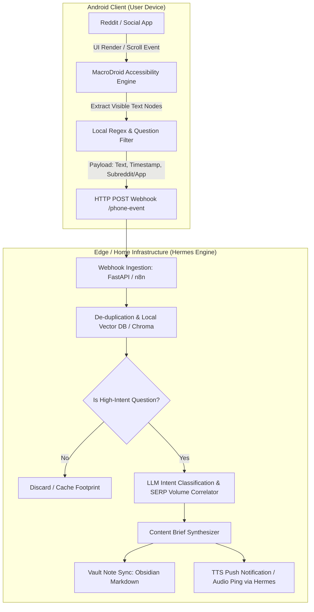

TITLE: Inverted Doomscroll: Real-Time Mobile Content Harvesting via Accessibility Telemetry
FILENAME: inverted-doomscroll-seo-harvester.md
TAGS: [seo-automation, macrodroid, hermes-agent, reddit-scraping, dynamic-content-engine, android-accessibility]
CONTENT:
---
title: "Inverted Doomscroll: Real-Time Mobile Content Harvesting via Accessibility Telemetry"
created: 2026-09-21
updated: 2026-09-21
type: engineering-blueprint
tags: [seo-automation, macrodroid, hermes-agent, reddit-scraping, dynamic-content-engine, android-accessibility]
sources: ["[[findquestions-com-seo-tool]]", "[[macrodroid-doomscroll-overseer]]"]
status: active
confidence: high
---

# Inverted Doomscroll: Real-Time Mobile Content Harvesting via Accessibility Telemetry

## 1. Executive Summary & Collision Thesis

Traditional SEO discovery tools like [[findquestions-com-seo-tool]] rely on static, scheduled API queries against target subreddits, which creates high latency, misses fleeting trends, and incurs rate-limiting or heavy SaaS costs. Conversely, [[macrodroid-doomscroll-overseer]] uses low-level Android UI accessibility triggers strictly as a disciplinary tool—monitoring screen state to intercept unproductive social media usage.

**The Synthesis:** The **Inverted Doomscroll Harvester** transforms compulsive mobile media browsing into an automated, edge-driven SEO intelligence node. Instead of punishing the user for scrolling through social platforms (Reddit, X, YouTube, LinkedIn, Facebook), an accessibility-level MacroDroid listener intercepts UI viewport nodes, scrapes real-time customer questions and complaints currently rendered on the mobile display, and streams them into [[hermes-agent]]. 

The Hermes backend clusters question semantics, quantifies search intent, evaluates organic ranking difficulty, and immediately writes programmatic article briefs or FAQ schemas into the user's second brain.

---

## 2. System Architecture



---

## 3. Core Mechanics

### Phase A: Zero-Overhead Edge Capture (MacroDroid)
Instead of polling the Reddit API (which is monetized, rate-limited, and often blocked on cloud scrapers), the user's real-device Android screen renders organic, algorithmically recommended threads directly inside the official app.

1. **Trigger:** `App In Foreground: com.reddit.frontpage` (or target social apps) + `Screen Interaction (Gesture: Swipe Up / Scroll)`.
2. **Action - UI Interaction:** MacroDroid uses UI Interaction with the `Inspect View Hierarchy / Content Description` action, dumping visible text elements into a local string variable `%scr_text%`.
3. **Regex Extraction (Client-Side Gatekeeper):**
   ```regex
   (?i)\b(how (do|can|to)|why (does|is|are)|what('s| is| are)|is there any way|anyone know)\b[^?]*\?
   ```
4. **Relay:** Emits an HTTP POST request to the local network or Tailscale IP (`http://10.117.196.61:5678/webhook/reddit-harvest`) with JSON:
   ```json
   {
     "source_app": "com.reddit.frontpage",
     "scraped_text": "%scr_text%",
     "timestamp": "%TIMEMS%",
     "screen_context": "viewport_dump"
   }
   ```

### Phase B: Telemetry Classification & Vector Ingestion ([[hermes-agent]])
1. **Deduplication:** Hermes hashes the incoming string using MinHash/LSH to avoid capturing the same Reddit post multiple times during a slow scroll.
2. **Intent Parsing:** Hermes passes the candidate strings through a lightweight model (e.g., Qwen 2.5 7B / Claude 3.5 Haiku) to filter genuine commercial/technical queries from meme threads and noise.
3. **Metadata Enrichment:**
   - Detects niche category (e.g., *DevOps, Roofing, Local Services, Tech*).
   - Estimates Search Intent: *Informational, Commercial Investigation, Transactional*.
   - Generates programmatic title and targeted Long-Tail Keyword variants.

### Phase C: Dual Feedback Loop
1. **Passive Knowledge Synthesis:** Hermes formats an Obsidian note inside the `Inbox/SEO-Ideas/` folder containing the question, contextual thread details, and a drafted H2/H3 outline.
2. **Active Audio Overseer Loop:** If the captured question matches a pre-configured high-priority client niche, Hermes fires a webhook back to MacroDroid:
   - Plays a custom TTS prompt through the user's earbuds: *"SEO Golden Goose detected: 'How do I migrate self-hosted runners to ARM64?' Added to Content Backlog."*

---

## 4. Implementation Blueprint

### Step 1: MacroDroid Inverted Overseer Action Block
Configure MacroDroid variable actions:
- **Local Variable:** `raw_screen_str` (String)
- **Local Variable:** `matched_question` (String)
- **Trigger:** System > UI Interaction Event > Click/Scroll within `com.reddit.frontpage`
- **Actions:**
  1. *UI Interaction* -> Extract Visible Text -> Target Variable: `raw_screen_str`
  2. *Text Manipulation* -> Regex Extract -> Pattern: `([A-Z][^\.!\?]*\?)` -> Output: `matched_question`
  3. *HTTP Request*:
     - **Method:** `POST`
     - **URL:** `http://10.117.196.61:5678/webhook/reddit-harvest`
     - **Headers:** `Content-Type: application/json`
     - **Body:**
       ```json
       {
         "client_id": "phone-overseer-01",
         "captured_content": "{lv=matched_question}",
         "full_buffer": "{lv=raw_screen_str}",
         "active_window": "{v=fg_app_name}"
       }
       ```

### Step 2: Hermes Agent Endpoint (`fastapi` / `n8n`)

```python
from fastapi import FastAPI, BackgroundTasks
from pydantic import BaseModel
import hashlib
import os

app = FastAPI()
SEEN_HASHES = set()

class HarvestPayload(BaseModel):
    client_id: str
    captured_content: str
    full_buffer: str
    active_window: str

def process_seo_opportunity(query_text: str):
    # Hermes logic: LLM categorization & Markdown write
    filename = f"SEO-Opportunity-{hashlib.md5(query_text.encode()).hexdigest()[:8]}.md"
    markdown_content = f"""---
type: seo-lead
status: unread
source: inverted-doomscroll
origin_app: mobile-reddit
tags: [seo, content-idea, organic-demand]
---

# Customer Question
> {query_text}

## Automated Content Strategy
- **Target Long-Tail Keyphrase:** `{query_text.rstrip('?')}`
- **Suggested Format:** FAQ Block / How-To Technical Guide
- **Search Intent:** Informational / High Commercial Signal
"""
    vault_path = os.path.expanduser(f"~/vault/inbox/{filename}")
    with open(vault_path, "w") as f:
        f.write(markdown_content)

@app.post("/webhook/reddit-harvest")
def ingest_harvest(payload: HarvestPayload, background_tasks: BackgroundTasks):
    text = payload.captured_content.strip()
    if not text or len(text) < 15:
        return {"status": "ignored_too_short"}
        
    text_hash = hashlib.sha256(text.encode()).hexdigest()
    if text_hash in SEEN_HASHES:
        return {"status": "duplicate"}
        
    SEEN_HASHES.add(text_hash)
    background_tasks.add_task(process_seo_opportunity, text)
    return {"status": "enqueued", "extracted_question": text}
```

---

## 5. Strategic Advantages

1. **Circumvents SaaS Subscriptions & Scraper Blocking:** FindQuestions.com and similar tools require constant API maintenance or scraping infrastructure vulnerable to Cloudflare/Reddit anti-bot protections. By utilizing your personal Android UI viewport as the crawler, scraping detection is impossible.
2. **Transforms Compulsive Behavior into Tangible Asset Value:** Converts mindless doomscrolling into an automated, ambient content-research mechanism.
3. **Hyper-Personalized Recommendation Graph:** The content extracted matches the user’s specialized Reddit algorithm and community subreddits, discovering hyper-niche pain points that generic keyword tools cannot find.