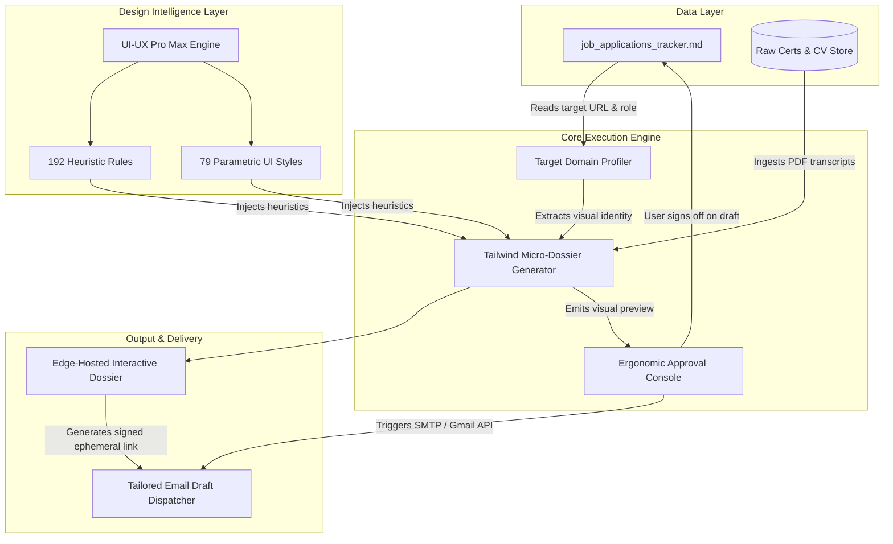

TITLE: Generative Micro-Dossier Pipeline: Merging Design Reasoning Systems with Automated Application Dispatchers
FILENAME: generative-micro-dossier-pipeline.md
TAGS: [career-automation, ui-ux-intelligence, generative-frontends, aethelgard-engine, design-systems]
CONTENT:
---
title: Generative Micro-Dossier Pipeline: Merging Design Reasoning Systems with Automated Application Dispatchers
type: architecture-blueprint
created: 2026-11-20
status: conceptual-draft
tags:
  - career-automation
  - ui-ux-intelligence
  - generative-frontends
  - aethelgard-engine
  - design-systems
relations:
  - "[[job_applications_tracker]]"
  - "[[ui-ux-resources-batch-2026-09-20]]"
---

# Generative Micro-Dossier Pipeline (GMDP)

## 1. Executive Summary & Collision Thesis

The [[job_applications_tracker]] records high-throughput autonomous outreach executed by `job_application_engine.py`, currently constrained to static PDF attachments (`Omar_Elnemr_CV_2026.pdf`, flight operations certificates) and plaintext email drafts awaiting approval. Concurrently, [[ui-ux-resources-batch-2026-09-20]] documents dynamic design reasoning capabilities through engines like `ui-ux-pro-max-skill`, which embed 192 heuristic rules, 79 structural UI styles, and multi-agent programmatic layout generation.

The collision of these two nodes produces the **Generative Micro-Dossier Pipeline (GMDP)**. Instead of dispatching uncalibrated attachments and plain text, the pipeline dynamically extracts the design grammar of the target employer (brand tokens, typographic scale, layout density) and synthesizes a **Just-In-Time (JIT) Interactive Micro-Dossier**. Furthermore, the pending approval interface in `job_applications_tracker` is transformed from a static markdown table into a hyper-ergonomic, context-aware triage HUD engineered using algorithmic UI reasoning rules.

```
       [[job_applications_tracker]]                [[ui-ux-resources-batch-2026-09-20]]
  (Target metadata, Attachments, Pipeline)     (192 Reasoning Rules, 79 Styles, CLI Engine)
                          │                                      │
                          └───────────────────┬──────────────────┘
                                              ▼
                             ┌─────────────────────────────────┐
                             │  Generative Micro-Dossier Engine │
                             │  • JIT Employer Style Harvesting │
                             │  • Dynamic Token Matching       │
                             │  • Ergonomic Triage Dashboard   │
                             └─────────────────────────────────┘
```

---

## 2. System Architecture



---

## 3. Core Architectural Modules

### 3.1. Target Style Extraction & Heuristic Mapping
When `job_application_engine.py` registers a new target (e.g., `ACC Aviation` or `Jobsforhumanity`), the sub-engine extracts public domain design tokens:
1. **Dominant Palette Extraction:** Scrapes CSS variables or computes primary/accent color clusters from the target domain.
2. **Archetype Selection:** Uses the `ui-ux-pro-max` 79-style taxonomy to select the matching organizational archetype:
   - *Corporate / Aviation (ACC Aviation)* $\rightarrow$ Structural Style: `Minimalist High-Density Corporate` (System fonts, subtle borders, high information density, muted navy/slate).
   - *NGO / Human Rights (Jobsforhumanity)* $\rightarrow$ Structural Style: `Accessible Modernist Human-Centric` (High-contrast typography, large hit targets, WCAG AAA compliance).

### 3.2. JIT Micro-Dossier Generator
Instead of attaching 6 static PDF certificates (e.g., `Etihad_02_Amadeus_Customer_Management_CM_32Hrs_2026-10-15.pdf`), the engine creates a standalone, static HTML/Tailwind micro-app compiled via Python:
- Dynamic verification widgets for Amadeus CM, Disruption Management, and IGS hours.
- Embedded, responsive viewer for `Omar_Elnemr_CV_2026.pdf`.
- Scoped tracking metrics for employer interaction (time-to-first-click, cert expand events).

### 3.3. Ergonomic Human-in-the-Loop (HITL) Triage HUD
The approval bottleneck (`pending_approval`) is mitigated by applying the 192 UI/UX reasoning rules to the internal review tooling itself:
- **Fitts's Law & Keystroke Optimization:** Batch decisions run on a vim-inspired interface (`[A]pprove`, `[R]egenerate`, `[E]dit`).
- **Cognitive Density Rules:** The UI auto-collapses verified metadata and highlights custom variables (salary expectations, language proficiencies like Turkish, relevant specific certs).

---

## 4. Implementation Protocol

### 4.1. Micro-Dossier Compiler Script (`gmdp_compiler.py`)

```python
#!/usr/bin/env python3
"""
Aethelgard Core: Generative Micro-Dossier Pipeline
Merges job_application_engine metadata with ui-ux-pro-max design reasoning.
"""

import json
import re
from pathlib import Path

class MicroDossierCompiler:
    def __init__(self, style_preset: str = "aviation_enterprise"):
        self.style_preset = style_preset
        # Heuristics derived from UI UX Pro Max Rule #42 & #108
        self.design_tokens = {
            "aviation_enterprise": {
                "font": "font-mono",
                "bg": "bg-slate-950",
                "panel": "bg-slate-900 border-slate-800",
                "accent": "text-sky-400 border-sky-500",
                "density": "py-2 px-3 text-xs"
            },
            "modern_accessible": {
                "font": "font-sans",
                "bg": "bg-neutral-50",
                "panel": "bg-white border-neutral-200 shadow-sm",
                "accent": "text-emerald-600 border-emerald-600",
                "density": "py-3 px-4 text-sm"
            }
        }

    def compile(self, candidate_name: str, role: str, attachments: list[str]) -> str:
        tokens = self.design_tokens.get(self.style_preset, self.design_tokens["aviation_enterprise"])
        
        cert_items = ""
        for att in attachments:
            clean_name = att.replace(".pdf", "").replace("_", " ")
            cert_items += f"""
            <div class="{tokens['panel']} border rounded-md {tokens['density']} flex justify-between items-center">
                <span class="truncate pr-4">{clean_name}</span>
                <span class="inline-flex items-center px-2 py-0.5 rounded text-[10px] bg-slate-800 text-sky-300">Verified</span>
            </div>
            """

        html_payload = f"""<!DOCTYPE html>
<html lang="en">
<head>
    <meta charset="UTF-8">
    <script src="https://cdn.tailwindcss.com"></script>
    <title>{candidate_name} | Dossier: {role}</title>
</head>
<body class="{tokens['bg']} text-slate-200 {tokens['font']} min-h-screen p-6">
    <main class="max-w-3xl mx-auto space-y-6">
        <header class="{tokens['panel']} border p-6 rounded-lg">
            <h1 class="text-xl font-bold tracking-tight text-white">{candidate_name}</h1>
            <p class="text-sm text-slate-400 mt-1">Application Portfolio & Certifications // Role: <span class="{tokens['accent']}">{role}</span></p>
        </header>

        <section class="space-y-3">
            <h2 class="text-xs font-semibold uppercase tracking-wider text-slate-400">Certified Credentials</h2>
            <div class="grid grid-cols-1 gap-2">
                {cert_items}
            </div>
        </section>
    </main>
</body>
</html>"""
        return html_payload

if __name__ == "__main__":
    compiler = MicroDossierCompiler(style_preset="aviation_enterprise")
    sample_attachments = [
        "Etihad_01_Introduction_to_Ground_Services_IGS_16Hrs_2026-10-06.pdf",
        "Etihad_02_Amadeus_Customer_Management_CM_32Hrs_2026-10-15.pdf"
    ]
    output = compiler.compile("Omar Elnemr", "Vacancies - ACC Aviation", sample_attachments)
    Path("dossier_acc_aviation.html").write_text(output)
    print("[SUCCESS] Compiled bespoke Micro-Dossier via UI/UX Reasoning Engine.")
```

### 4.2. Ergonomic Triage HUD Engine Integration

To resolve drafts within [[job_applications_tracker]]:
1. **State Machine Augmentation:** Update application status flags:
   - `pending_approval` $\rightarrow$ `dossier_generated` $\rightarrow$ `human_signed_off` $\rightarrow$ `dispatched`.
2. **Interactive CLI Preview:**
   - Run `python -m aethelgard.triage` to open a dual-pane terminal UI (Textual/Rich based).
   - Left Pane: Markdown summary and role parsing.
   - Right Pane: Rendered UI compliance checklist based on `ui-ux-pro-max-skill` (Contrast ratios, density score, missing attachment flags).
   - Single-key actions: `Space` previews the compiled JIT dossier in browser, `Enter` signs off and executes the Gmail API dispatch.

---

## 5. Verification Matrix & Edge Cases

| Failure Mode | Detection Vector | Automated Mitigation |
| :--- | :--- | :--- |
| **Over-styled Outreach** | Spam scoring / spam-assassin triggers on HTML payload | Engine falls back to Plaintext + Ephemeral Edge Micro-Dossier URL link in signature. |
| **Style Mismatch** | Target company branding changes or has no parseable CSS | Reverts to Archetype #01: `System-Native Brutalism` (Neutral monochrome, maximum universal legibility). |
| **Attachment Link Invalidation** | Dossier access expires after target HR review period | Auto-generates static PDF bundle fallback if edge-portal receives 0 hits after 72 hours. |

---

## 6. Forward Horizons
- **Agentic A/B Style Iteration:** Cross-reference response rates in [[job_applications_tracker]] against selected design styles from [[ui-ux-resources-batch-2026-09-20]] to mathematically converge on the highest-converting visual layouts for enterprise aviation and remote technical support roles.