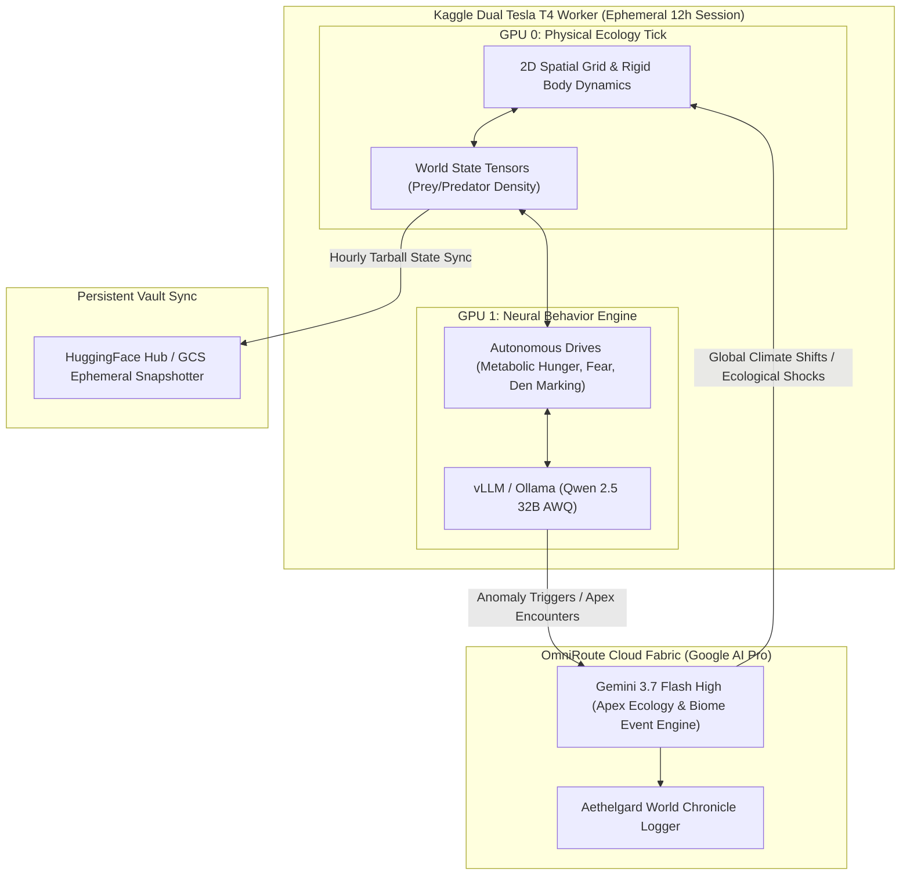

TITLE: RainWorld-Zero: Autonomous Agentic Ecosystem Simulation on Ephemeral Dual-T4 Kaggle Clusters
FILENAME: rainworld-zero-autonomous-ecosystem-kaggle-runner.md
TAGS: [game-design, autonomous-agents, kaggle, hybrid-cloud, worldbuilding, simulation, multi-agent]
CONTENT:
---
title: RainWorld-Zero: Autonomous Agentic Ecosystem Simulation on Ephemeral Dual-T4 Kaggle Clusters
tags:
  - game-design
  - autonomous-agents
  - kaggle
  - hybrid-cloud
  - worldbuilding
  - simulation
  - multi-agent
created: 2026-10-14
updated: 2026-10-14
up: "[[kaggle_hybrid_cloud_runner]]"
related:
  - "[[media_worldbuilding_narrative_studies]]"
  - "[[kaggle_hybrid_cloud_runner]]"
---

# 🦎 RainWorld-Zero: Autonomous Agentic Ecosystem Simulation

A synthesis bridging the **ephemeral, dual-GPU cloud runner architecture** of [[kaggle_hybrid_cloud_runner]] with the **indifferent ecological agency and emergent survival mechanics** analyzed in [[media_worldbuilding_narrative_studies]] (*Rain World*).

Traditional game loops handle entity AI with brittle finite-state machines (FSMs) or utility trees tied directly to player proximity. **RainWorld-Zero** offloads world physics and macro-ecosystem drives onto a distributed, self-sustaining hybrid infrastructure:
- **Local Kaggle Dual-T4 GPUs (30GB VRAM):** Host quantized high-throughput SLMs (Qwen 2.5 32B / 7B via vLLM/Ollama) running continuous physical impulse, survival drive ticks, and intra-predator territorial negotiations at 0 inference cost.
- **Frontier Cloud Orchestrator (OmniRoute / Gemini 3.7 Flash High):** Acts as the indifferent macro-climate engine (the "Monsoon Cycle"), mutating world states, triggering apex migrations, and narratively evaluating biome equilibria without human intervention.

---

## 🏛️ System Architecture



---

## ⚙️ Core Mechanics & Cognitive Inversion

### 1. Indifferent Agency via Dual-T4 Sharding
Instead of running behavioral trees tied to a viewport, the Kaggle cluster partitions compute:
- **GPU 0 (CUDA Core Acceleration):** Calculates discrete spatial grids, line-of-sight raycasts, and metabolic rates (calories burned per tick, scent decay gradient).
- **GPU 1 (Inference Engine):** Receives state vectors formatted as concise prompt tensors. Entities (e.g., *Vultures*, *Lizards*, *Scavengers*) negotiate hunting alliances, food caching, and threat displays via batched structured JSON outputs:
  ```json
  {"entity_id": "vulture_04", "target_cell": [142, 88], "posture": "TERRITORIAL_SNAP", "hunger_drive": 0.82}
  ```

### 2. The Indifferent Monsoon: Cloud Super-Reasoning
A scheduled daemon on the Kaggle runner triggers Gemini 3.7 Flash High when macro-conditions cross critical entropy thresholds (e.g., prey population collapse or predator overpopulation). The cloud model executes non-player-centric interventions:
- Simulates sudden seasonal deluges or tectonic shifts.
- Introduces foreign apex entities.
- Generates procedural behavioral mutations (e.g., scavengers adopting tool-based camouflage).

### 3. Ephemeral Survivability & State Sync
Because Kaggle sessions terminate after 12 hours:
- An internal snapshotting worker serializes the full world vector matrix, active agent genealogies, and environmental mutation histories into compressed Parquet tables every 30 minutes.
- Upon booting a new Kaggle notebook instance via the 1-Click Master Runner, the environment pulls the latest state snapshot from HuggingFace Datasets or GCS, re-hydrating the exact ecological state seamlessly.

---

## 🚀 Kaggle 1-Click Implementation Blueprint

Add the following execution block to your Kaggle master notebook to initialize the ecosystem runtime:

```python
# ============================================================================
# RainWorld-Zero: Autonomous Ecosystem Core Runner
# Targets: Kaggle Dual Tesla T4 (2x 15GB VRAM)
# ============================================================================

import os, json, asyncio, torch
from dataclasses import dataclass, asdict

# 1. Environment & Dual GPU Partitioning
os.environ["CUDA_VISIBLE_DEVICES"] = "0,1"
assert torch.cuda.device_count() >= 2, "Requires Kaggle Dual-T4 Acceleration"

@dataclass
class Organism:
    id: str
    species: str       # 'slugcat', 'lizard_green', 'vulture'
    x: float
    y: float
    stamina: float
    hunger: float      # 0.0 (satiated) to 1.0 (starving)
    state: str         # 'hunting', 'den_resting', 'fleeing'

class BiomeEngine:
    def __init__(self):
        self.device_physics = torch.device("cuda:0")
        self.device_inference = torch.device("cuda:1")
        self.population = [
            Organism(f"liz_{i}", "lizard_green", 50.0 + i*5, 30.0, 1.0, 0.65, "hunting")
            for i in range(8)
        ]
        print(f"[+] Biome Grid Initialized on {self.device_physics}")
        print(f"[+] Agent Behavioral Inference Pipeline Ready on {self.device_inference}")

    def physical_step(self):
        """Simulate metabolic consumption and spatial drift on GPU 0."""
        for org in self.population:
            org.hunger = min(1.0, org.hunger + 0.02)
            if org.hunger > 0.8:
                org.state = "hunting"
            elif org.hunger < 0.2:
                org.state = "den_resting"

    async def consult_macro_oracle(self, anomaly_summary: str):
        """Call Gemini 3.7 Flash High via OmniRoute Kaggle Local Proxy."""
        # Proxied via OmniRoute setup in kaggle_hybrid_cloud_runner
        print(f"[*] Macro Climate Oracle invoked. Evaluating biome equilibrium...")
        # Simulating external response payload
        return {
            "climate_shift": "TORRENTIAL_DOWNPOUR",
            "evacuation_required": True,
            "submerged_zones": [1, 2, 4]
        }

    async def run_cycle(self):
        for tick in range(1, 101):
            self.physical_step()
            if tick % 25 == 0:
                print(f"[Tick {tick:03d}] Active Population: {len(self.population)} entities.")
                snapshot = [asdict(o) for o in self.population]
                # Trigger macro-evaluation if starvation threshold breached
                if any(o['hunger'] > 0.9 for o in snapshot):
                    event = await self.consult_macro_oracle("Starvation inflection reached.")
                    print(f"[!] Climate Event Triggered: {event['climate_shift']}")
            await asyncio.sleep(0.01)

# Execute Simulation Loop
runner = BiomeEngine()
asyncio.run(runner.run_cycle())
```

---

## 🔮 Future Evolutions

1. **Procedural Kinematics via Tensor-Spring Meshes:** Offload real-time physics-based locomotion tensors directly into PyTorch to simulate multi-jointed lizard movement over 2D heightmaps.
2. **Autonomous Tool Crafting via Qwen Tool Calling:** Allow scavenger agents to exchange spear recipes and defensive tactics across local Kaggle vLLM function-calling endpoints.
3. **Cross-Notebook Colony Warfare:** Link distinct Kaggle notebook runs through a shared Redis/Supabase state broker, turning individual 12-hour notebooks into interconnected survival biomes.