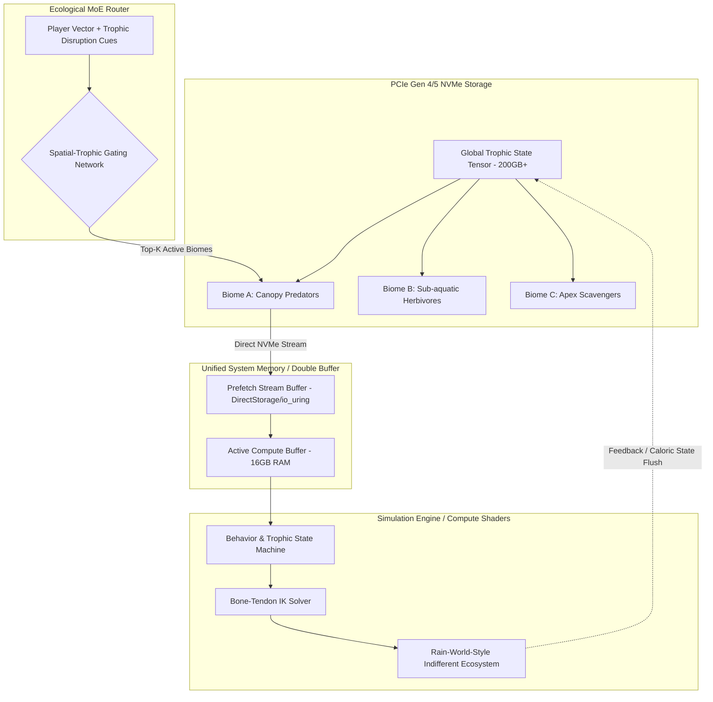

TITLE: NVMe-Streamed Sparse Mixture-of-Ecosystems (MoEco) for Planetary-Scale Autonomous Simulation
FILENAME: nvme-streamed-sparse-mixture-of-ecosystems.md
TAGS: [gamedesign, ai-infrastructure, worldbuilding, simulation, memory-offloading, sparse-computation]
CONTENT:
---
title: "NVMe-Streamed Sparse Mixture-of-Ecosystems (MoEco) for Planetary-Scale Autonomous Simulation"
date: 2026-10-02
type: architectural-synthesis
status: concept-prototype
aliases: [MoEco, Sparse Ecosystem Streaming, Biome MoE Offloading]
tags: [gamedesign, ai-infrastructure, worldbuilding, simulation, memory-offloading, sparse-computation]
see_also:
  - "[[media_worldbuilding_narrative_studies]]"
  - "[[2026-10-01-ssd-streaming-744b-model-inference-colibri]]"
---

# NVMe-Streamed Sparse Mixture-of-Ecosystems (MoEco)

## 1. Executive Collision Concept

In *Rain World*, the primary illusion of an indifferent world stems from autonomous, off-screen ecological loops—creatures migrate, hunt, mate, and die across hundreds of connected rooms regardless of player locality. However, scaling an ecosystem with unscripted physics, trophic state-machines, and procedural skeletal animation to an entire open world (e.g., 500,000+ autonomous agents across planetary biomes) crashes against the classic memory wall: **RAM & VRAM limitations**.

Simultaneously, SSD-streaming inference architectures (such as **Colibri**, **AirLLM**, and **KTransformers**) solved the 700B+ Mixture-of-Experts (MoE) footprint problem: rather than loading all weights into system memory, they treat storage as an asynchronous activation bank, streaming only the sparse, actively routed experts (10–20 GB/step) into working memory over PCIe Gen 4/5 channels.

**The Synthesis:** **Sparse Mixture-of-Ecosystems (MoEco)**. 
We treat an indifferent, planetary-scale ecological simulation as a sparse mixture network. Rather than running monolithic entity loops or dumbing distant creatures down to zero-cost statistical counters, the world is partitioned into a hierarchical trophic graph stored on high-speed NVMe storage. Trophic triggers, migration cues, and biome router gates dynamically page agent state-tensors, neural sensory weights, and physical bone-tendon matrices into unified RAM/VRAM just-in-time for physical evaluation ticks.

---

## 2. Core Architectural Pillars

### A. The Biome Expert Router (MoE Spatial Gating)
- The planetary topology is subdivided into **Trophic Clusters** (Experts).
- An asynchronous **Ecological Router Engine** continuously evaluates low-frequency environmental signals (weather fronts, apex predator roaming radius, resource depletion gradients).
- Like a Top-$K$ gating network in an MoE model, only the active biomes directly perturbed by player proximity OR cascading ecological events (e.g., a migration herd or flood surge) are loaded into high-tier unified memory.

### B. Tiered Ecological Fidelity (Off-Screen LOD Tiers)
1. **Tier 0 (SSD Inactive):** Serialized cold state tensors (position, caloric store, age, injury vectors) packed into compressed, contiguous blocks formatted for direct DMA access via `io_uring` or DirectStorage.
2. **Tier 1 (RAM Macro-Trophic Loop):** Low-frequency macro simulation (1 tick/sec): hunting probability, pathfinding along coarse navgraphs, hunger depletion.
3. **Tier 2 (VRAM/Unified Micro-Trophic Loop):** High-frequency physics, IK procedural animation, visual bone-physics, and dynamic sensory computation evaluated at full fidelity.

### C. Ring-Buffered Direct NVMe-to-RAM Streaming
- Adopting **Colibri’s layer-pipelined forward pass**, the world engine streams biome agent state-tensors through a double-buffered ring cache.
- Forward evaluation occurs in discrete chronological sweeps: as the simulation engine advances the tick for Region $\alpha$, Region $\beta$'s agent weights are paged asynchronously from NVMe over PCIe Gen 4/5 ($>6 \text{ GB/s}$), avoiding frame drops.

---

## 3. Architecture Pipeline



---

## 4. Concrete Implementation Blueprint

### Step 1: Contiguous Binary State Chunking for Zero-Copy I/O
Agent entities are packed without pointer indirection to allow direct memory mapping (`mmap` / Linux `io_uring` / Windows DirectStorage):

```rust
// Unified POD struct for zero-deserialization memory mapping
#[repr(C, align(64))]
#[derive(Clone, Copy, Debug)]
pub struct EcologicalAgentState {
    pub entity_id: u64,
    pub species_id: u16,
    pub hunger_level: f32,
    pub stamina: f32,
    pub world_position: [f32; 3],
    pub velocity: [f32; 3],
    pub territorial_anchor: [f32; 3],
    pub current_target_id: u64,
    pub flags: u32, // Bitflags: InCombat, IsStalking, Hibernating, etc.
}
```

### Step 2: The Direct SSD Streaming Consumer (`io_uring` Kernel Dispatch)
High-throughput asynchronous prefetcher streaming agent clusters without blocking the main render or simulation loops:

```cpp
#include <liburing.h>
#include <fcntl.h>

class EcosystemStreamer {
public:
    void PrefetchBiomeChunk(int fd, off_t offset, size_t bytes, void* target_buffer) {
        struct io_uring_sqe *sqe = io_uring_get_sqe(&ring);
        io_uring_prep_read(sqe, fd, target_buffer, bytes, offset);
        io_uring_sqe_set_data(sqe, target_buffer);
        io_uring_submit(&ring);
    }

    void CompleteTransfers() {
        struct io_uring_cqe *cqe;
        while (io_uring_peek_cqe(&ring, &cqe) == 0) {
            // Buffer ready: Route agent states into Compute Shader dispatch buffers
            io_uring_cqe_seen(&ring, cqe);
        }
    }
private:
    struct io_uring ring;
};
```

### Step 3: Compute Shader Bone-Physics & Autonomous Behavior Tick
Once paged into host/device memory, agents calculate skeletal procedural locomotion and predation vectors on the GPU:

```hlsl
// Compute Shader: Ecological Evaluation Tick
struct Agent {
    uint entity_id;
    uint species_id;
    float hunger;
    float stamina;
    float3 pos;
    float3 vel;
    float3 anchor;
    uint target_id;
    uint flags;
};

StructuredBuffer<Agent> InAgents : register(t0);
RWStructuredBuffer<Agent> OutAgents : register(u0);

[numthreads(64, 1, 1)]
void CSMain(uint3 DTid : SV_DispatchThreadID) {
    Agent a = InAgents[DTid.x];
    
    // 1. Biological clock & metabolism
    a.hunger = saturate(a.hunger + 0.0001f);
    
    // 2. Autonomous predator-prey dynamics
    if (a.hunger > 0.7f) {
        // Evaluate scent/vision radius against local spatial hash
        a.vel += SeekFood(a.pos, a.species_id);
    } else {
        // Default territorial patrol cycle
        a.vel += PatrolTerritory(a.pos, a.anchor);
    }
    
    // 3. Integrate position & write back
    a.pos += a.vel * 0.0166f;
    OutAgents[DTid.x] = a;
}
```

---

## 5. Strategic Implications for Game Design & Worldbuilding

1. **True Planetary Indifference:** Players are no longer the origin point of existence. A mega-predator pack on the opposite continent hunts, exhausts food stocks, and migrates toward the player's region over days of play time—operating under real physics and state dynamics, even on consumer hardware with 16GB of RAM.
2. **Elimination of "Despawn Cheese":** In games like *Skyrim* or *Far Cry*, enemies vanish or reset when retreating past an arbitrary leash distance. With NVMe sparse offloading, an injured predator that escapes the player survives, carries physical scarring, retreats to its lair on disk, and can be tracked sessions later.
3. **Sub-Watt High-Density Worlds on Consumer Hardware:** By taking the core breakthrough of the 2026 LLM democratization wave (AirLLM/Colibri SSD streaming) and porting it to game mechanics, simulation fidelity scales with disk size rather than prohibitively expensive VRAM. A 2TB NVMe SSD can host a living, breathing planet with 100,000,000 biologically persistent organisms.