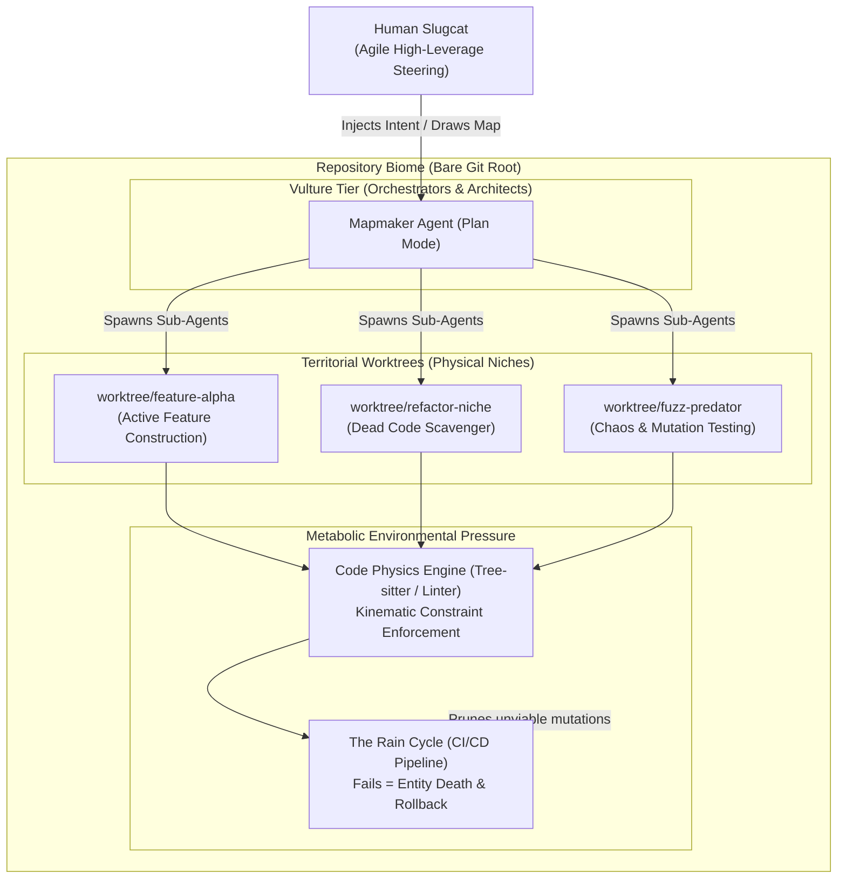

TITLE: Ecological Agent Swarms: Autonomous Multi-Worktree Codebase Ecosystems
FILENAME: ecological-agent-swarms-autonomous-worktrees.md
TAGS: [agentic-coding, worldbuilding-systems, claudecode, git-worktrees, simulation-design, software-architecture]
CONTENT:
---
title: "Ecological Agent Swarms: Autonomous Multi-Worktree Codebase Ecosystems"
created: 2026-10-25
type: synthesis
tags: [agentic-coding, worldbuilding-systems, claudecode, git-worktrees, simulation-design, software-architecture]
status: experimental
up: "[[media_worldbuilding_narrative_studies]]", "[[claude-code-boris-cherny-power-user-playbook]]"
---

# 🧬 Ecological Agent Swarms: Autonomous Multi-Worktree Codebase Ecosystems

## 💡 Executive Collision

Traditional software engineering tools treat AI coding agents like subordinate NPCs bound to a single player's terminal loop—they activate only when summoned, execute a linear diff, and terminate. 

By colliding the **autonomous ecosystem simulation of *[[media_worldbuilding_narrative_studies|Rain World]]*** (where predators, prey, and ambient cycles interact indifferent to player proximity via physical and metabolic constraints) with **Boris Cherny’s [[claude-code-boris-cherny-power-user-playbook|Claude Code power-user patterns]]** (multi-agent parallelism, git-worktree isolation, and strict "Draw the Map Before You Walk" planning), we create a radical paradigm: **The Codebase as an Indifferent Ecosystem.**

Instead of ephemeral CLI invocations, agents exist as continuous, autonomous "predators," "scavengers," and "engineers" roaming isolated Git worktrees. The human developer is no longer a micro-managing puppeteer, but a fragile, high-leverage entity navigating an active biological development lifecycle.

---

## 🏗️ The Ecological Multi-Agent Topology

In this architecture, your repository is not a static text dump; it is an active biome divided into territorial partitions (worktrees), governed by environmental cycles (CI runs / test-suite rains) and distinct predatory/symbiotic agents.



---

## ⚙️ Ecological Niches in Claude Code Worktrees

| Role | *Rain World* Analog | Claude Code Technical Equivalent | Operational Loop |
| :--- | :--- | :--- | :--- |
| **Architect Agent** | *Five Pebbles / Overseer* | Top-level Claude Code running `--plan` mode (`Ctrl-P`). | Emits structural dependency graphs (`PLAN.md`), sets territorial limits, and allocates worktree branches. |
| **Builder Swarm** | *Slugcat / Scavengers* | Parallel `claude` instances launched across distinct `git worktree add`. | Reads task boundaries, constructs code, trades commits via rebasing rather than manual intervention. |
| **Fuzz Predator** | *Lizard (Green / Magenta)* | Hostile autonomous agent running property-based tests and edge-case injections. | Hunts for memory leaks, unhandled exceptions, and type regressions in parallel worktrees. |
| **Pruning Scavenger** | *Garbage Worms* | Background CLI daemon auditing AST dead code and stale dependencies. | Continuously removes deprecated symbols and refactors bloated abstractions down to minimal interfaces. |
| **The Rain (Cycle End)** | *The Deadly Downpour* | Global Automated Test Suite / Benchmark gate. | Any worktree branch that cannot settle its merge conflicts or pass zero-regression thresholds before cycle expiration is hard-pruned (`git worktree remove --force`). |

---

## 🛠️ Implementation Blueprint: The Autonomous Habitat Runner

### 1. Worktree Ecosystem Bootstrap Script (`habitat.sh`)

This script initializes isolated biological niches (worktrees) and sets autonomous Claude agents loose within them using headless non-interactive mode with restricted execution perimeters.

```bash
#!/usr/bin/env bash
set -euo pipefail

REPO_ROOT=$(git rev-parse --show-toplevel)
CYCLE_TIMEOUT=1800 # 30 min rain cycle

echo "🌱 Initializing Repository Biome..."

# Create territorial isolation zones (Git Worktrees)
git worktree add -B habitat/builder ../wt-builder main
git worktree add -B habitat/scavenger ../wt-scavenger main
git worktree add -B habitat/predator ../wt-predator main

# Agent 1: Scavenger - Hunts and kills unused code
(
  cd ../wt-scavenger
  echo "🪱 Scavenger deployed: Pruning dead exports and untyped functions..."
  claude --non-interactive \
    -p "Audit all modules. Locate unreferenced functions or dead imports. Remove them, run tests, and commit with message 'refactor(scavenger): consume dead symbols'."
) &

# Agent 2: Predator - Attempts to break newly implemented contracts
(
  cd ../wt-predator
  echo "🦎 Predator deployed: Inverting invariants and probing edge cases..."
  claude --non-interactive \
    -p "Inspect recent diffs against main. Write aggressive fuzz tests in tests/predator/ designed to trigger unhandled promise rejections or boundary overflows. Commit passing adversarial tests."
) &

# Human-guided high-leverage Builder session
echo "⚡ Entering Architect/Slugcat worktree..."
cd ../wt-builder
claude
```

### 2. Environmental Constraint Gate (`.rain-cycle.sh`)

Just as *Rain World* organisms must reach a shelter before the flood drowns the region, autonomous agent worktrees must prove viability against rigorous kinematic constraints (Tree-sitter linting, strict types, latency budgets) before their work is subsumed into the `main` branch.

```bash
#!/usr/bin/env bash
# .rain-cycle.sh - Environmental validation

echo "🌧️ Rain is falling: Evaluating worktree fitness..."

# 1. Physics Engine Check: Strict AST / Typings
pnpm typecheck || { echo "💀 Crushed by physics: Typecheck failed."; exit 1; }

# 2. Functional Survival Check: Unit & Regression Suites
pnpm test:unit || { echo "💀 Swept away by the flood: Test failures detected."; exit 1; }

# 3. Structural Balance: No bloated bundle sizes or cyclic imports
pnpm madge --circular src/ || { echo "💀 Metabolic rot: Circular dependencies found."; exit 1; }

echo "☀️ Shelter reached. Code changes are viable for genetic merge."
```

---

## 🧬 Architectural Principles for the Paradigm Shift

1. **Procedural Code Evolution Over Static Generation:**  
   Don't ask an LLM to generate whole features in a vacuum. Let code mutate through physical constraints: AST analysis and unit tests act as the "bone physics and muscle simulation," preventing biologically impossible (syntactically invalid) code shapes.

2. **Decoupled Agent Agency:**  
   Boris Cherny’s insight that multi-agent speed comes from **parallel worktrees** scales when agents don't wait for human validation. The human becomes an opportunistic apex-navigator—steering overarching intent (`PLAN.md`), while background processes autonomously balance and defend the codebase.

3. **Indifferent Maintenance (Zero-Hero Engineering):**  
   The system rejects the fantasy of an all-knowing senior developer who holds the entire mental model. The repo survives because its internal ecological pressures (scavengers cleaning cruft, predators generating defensive fuzz tests) continuously adapt it against code rot.

---

## 🔗 Connected Notes
- [[media_worldbuilding_narrative_studies]] — Core dynamics of non-teleological game worlds and procedural kinetic behavior.
- [[claude-code-boris-cherny-power-user-playbook]] — Multi-agent orchestration, `PLAN.md` protocols, and terminal git-worktree topologies.
- [[agentic-infrastructure-primitives]] — Autonomous sandbox runners and deterministic execution sandboxes.