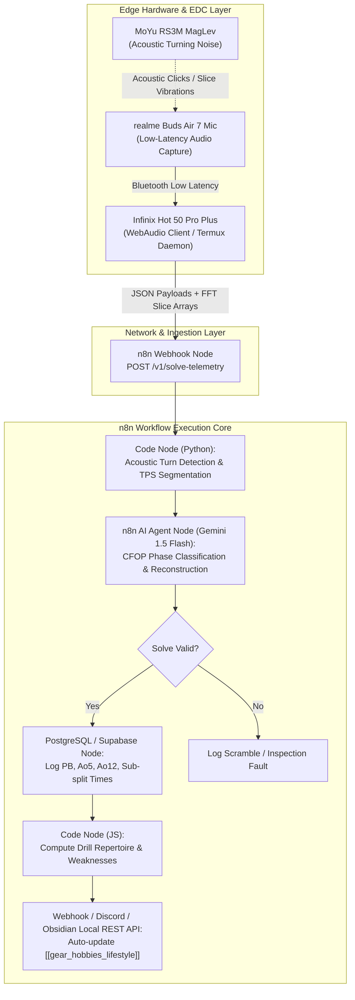

TITLE: ChronoCube: Automated Biometric-Acoustic Speedcubing Telemetry & Training Pipeline
FILENAME: chronocube-biometric-speedcubing-telemetry.md
TAGS: [speedcubing, n8n-automation, biometric-telemetry, edge-iot, cfop-optimization]
CONTENT:
---
title: ChronoCube: Automated Biometric-Acoustic Speedcubing Telemetry & Training Pipeline
aliases: [ChronoCube, Speedcubing Automation Engine, CFOP Telemetry Pipeline]
tags: [cubing, n8n, automation, edge-audio, cfop, personal-telemetry]
created: 2026-09-21
status: draft
domain_collision: [[n8n-workflow-automation]] × [[gear_hobbies_lifestyle]]
---

# ChronoCube: Automated Biometric-Acoustic Speedcubing Telemetry & Training Pipeline

## 1. Executive Concept & Cognitive Collision

The intersection of **[[gear_hobbies_lifestyle]]** (specifically speedcubing with non-electronic mechanical cubes like the **MoYu RS3M MagLev**, paired with mobile EDC and ANC wearables like the **realme Buds Air 7**) and **[[n8n-workflow-automation]]** (distributed event-driven microservice orchestration and native AI agents) yields **ChronoCube**.

Smart cubes (Bluetooth-enabled) suffer from altered magnetic weight distributions and unnatural tactile dynamics compared to competition-grade MagLev hardware. **ChronoCube** removes the need for embedded cube microcontrollers by converting ambient acoustic friction signatures and mobile camera feeds into an automated telemetry ingestion stream. 

Using an Android-native background bridge running on the **Infinix Hot 50 Pro Plus**, high-frequency audio captured via the **realme Buds Air 7** microphone array tracks turn frequency (TPS — Turns Per Second), phase transitions (Cross, F2L, OLL, PLL), and lockup anomalies. This stream is dispatched to a local/self-hosted **n8n** automation instance to execute algorithmic breakdown, reconstruct solve logs, calculate real-time rolling CFOP statistics, and dynamically modulate auditory feedback.

---

## 2. System Architecture



---

## 3. Acoustic Turn-Signature Processing Protocol

The dual repulsion rings of the **MoYu RS3M MagLev** produce an ultrasonic and mid-frequency acoustic profile distinct from spring-loaded cubes (such as the **QiYi Warrior S**), eliminating spring ping and amplifying mechanical boundary snap (~4.2 kHz peak).

### 3.1 FFT Segment Feature Extraction
1. **Inspection Phase ($t_0$ to $t_{start}$):** Cube pickup detection via ambient mic handling noise ($< 300\text{ Hz}$).
2. **Execution Phase ($t_{start}$ to $t_{end}$):** 
   - Slice turn: Short transient spike ($8\text{--}15\text{ ms}$, centered at $4.1\text{--}4.5\text{ kHz}$).
   - Regrip/Pause: Flatline silent window ($> 250\text{ ms}$ implies recognition latency between F2L pairs or OLL/PLL transitions).
3. **Completion Phase ($t_{end}$):** Cube slap down signature ($100\text{--}250\text{ Hz}$ high-energy dampening shockwave).

---

## 4. Concrete Implementation Steps

### Step 1: Deploy Ingestion Micro-Client on Mobile (Infinix Hot 50 Pro Plus)
Create a lightweight WebAudio script or run a Termux Python daemon capturing microphone buffer via OpenSL ES, computing local FFT peaks, and batching turn timestamps:

```javascript
// client-telemetry.js running in local PWA on Infinix Hot 50 Pro Plus
const socketPayload = {
  sessionId: crypto.randomUUID(),
  hardware: "MoYu RS3M MagLev",
  audioInput: "realme Buds Air 7 - Wideband Mic",
  startTime: performance.now(),
  turnTimestampsMs: [0, 180, 370, 540, 890, 1080, ...], // Delta click events
  totalDurationMs: 9420,
  solveScramble: "R U R' U' D R2 U' B2 L2 F2 U' L2 U' R2 B' L' R' F U2"
};

await fetch("https://n8n.internal.local/webhook/v1/solve-telemetry", {
  method: "POST",
  headers: { "Content-Type": "application/json" },
  body: JSON.stringify(socketPayload)
});
```

### Step 2: Configure n8n Workflow

1. **Webhook Node:**
   - **Path:** `/v1/solve-telemetry`
   - **Method:** `POST`
   - **Response Mode:** `On Received` (`{"status": "processing"}`)

2. **Python Code Node (`Acoustic CFOP Segmenter`):**
   ```python
   # n8n Python Code Node
   import numpy as np

   data = _input.first().json
   turns = np.array(data["turnTimestampsMs"])
   diffs = np.diff(turns)

   # Split clusters based on pauses exceeding threshold (recognition phases)
   # Recognition pauses in CFOP typically occur between Cross->F2L, and F2L4->OLL->PLL
   pause_indices = np.where(diffs > 300)[0]

   phases = {
       "cross": diffs[:pause_indices[0]].tolist() if len(pause_indices) > 0 else [],
       "f2l": diffs[pause_indices[0]:pause_indices[-2]].tolist() if len(pause_indices) > 2 else [],
       "oll": diffs[pause_indices[-2]:pause_indices[-1]].tolist() if len(pause_indices) > 2 else [],
       "pll": diffs[pause_indices[-1]:].tolist() if len(pause_indices) > 2 else []
   }

   tps = len(turns) / (data["totalDurationMs"] / 1000.0)

   return {
       "sessionId": data["sessionId"],
       "tps": round(tps, 2),
       "totalTimeSec": data["totalDurationMs"] / 1000.0,
       "phases": phases,
       "scramble": data["solveScramble"]
   }
   ```

3. **AI Agent Node (CFOP Algorithmic Coach):**
   - **System Prompt:** *"You are an elite speedcubing performance engineer. Evaluate the user's CFOP split times and TPS variance. Identify where recognition pauses exceeded acceptable limits (target: F2L transition < 250ms, OLL recognition < 200ms). Generate focused drill recommendations for MagLev tension balancing or algorithm drilling."*
   - **Connected Tool:** Dynamic Obsidian Vault updater to append session insights directly into `[[gear_hobbies_lifestyle]]`.

4. **Obsidian Local REST API Node / Markdown Append:**
   - Appends run telemetry directly into the Speedcubing section of Omar's second brain.

---

## 5. Next-Step Evolutions

- **Adaptive ANC Modulation:** Use the n8n execution output to send intent broadcasts to the `realme Link` app interface (via Android notification actions / Tasker automation), automatically engaging high ANC during inspection and switching to transparent passthrough when an execution phase finishes.
- **MagLev Magnetic Wear Profiling:** Track historical TPS decay across thousands of solves within PostgreSQL to predict internal silicone lubricant breakdown and magnet thermal dissipation limits.