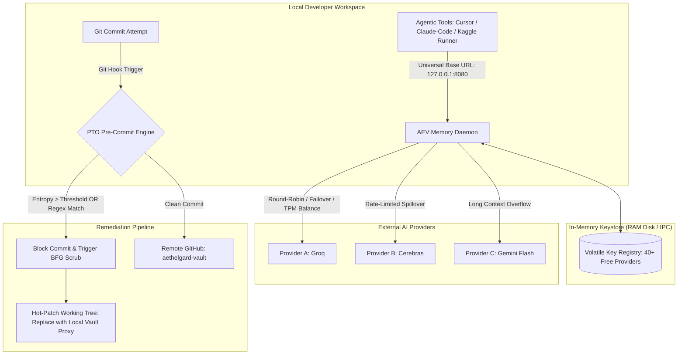

TITLE: Autonomous Ephemeral Vault Routing & Pre-Commit Token Obliteration (AEV-PTO)
FILENAME: autonomous-ephemeral-vault-routing-pre-commit-token-obliteration.md
TAGS: [security, llm-routing, git-hooks, token-lifecycle, free-tier, devops, bfg-repo-cleaner, agentic-workflows]
CONTENT:
---
title: "Autonomous Ephemeral Vault Routing & Pre-Commit Token Obliteration (AEV-PTO)"
created: 2026-10-24
updated: 2026-10-24
type: architectural-blueprint
tags: [security, llm-routing, git-hooks, token-lifecycle, free-tier, devops, bfg-repo-cleaner, agentic-workflows]
confidence: high
contested: false
contradictions: []
---

# Autonomous Ephemeral Vault Routing & Pre-Commit Token Obliteration (AEV-PTO)

## 1. Executive Summary & Cognitive Collision

The intersection of **high-density free-tier LLM API aggregation** ([[free-tier-llm-api-endpoints-routing]]) and **critical Git history secrets remediation** ([[security-action-git-history-secrets-audit]]) introduces a systemic paradox: 
> *Routing agentic workflows across 40+ free-tier API providers requires handling dozens of distinct API keys, bearer tokens, and base URLs. Storing these credentials across development scripts (e.g., `run_kaggle`, Cursor configs, Claude-Code shims) exponentially multiplies the blast radius of accidental public Git history exposure.*

The **AEV-PTO Architecture** resolves this tension by treating all LLM API credentials as **disposable, just-in-time runtime artifacts** managed via an automated local proxy. Concurrently, a zero-trust pre-commit kernel enforces dynamic entropy scanning and automated `git-filter-repo` / `bfg` hot-patching before any commit tree ever touches a remote.

---

## 2. Core Architecture

Instead of hardcoding keys in working tree files (`run_kaggle`, `.env`, configuration files), developer environments point to a single local pseudo-endpoint (e.g., `http://127.0.0.1:8080/v1`). The local daemon rotates requests dynamically across upstream free-tier providers using a memory-only credential pool.



---

## 3. Structural Mechanisms

### Mechanism A: In-Memory Ephemeral Provider Router (`aev-router`)
* Developers configure tools to consume standard OpenAI-compatible completions from `http://127.0.0.1:8080/v1`.
* The upstream secrets (OpenRouter, Groq, Mistral, Cerebras, Kaggle tokens) are ingested directly into an ephemeral shared-memory segment (or POSIX `/dev/shm`) at boot via encrypted 1Password CLI (`op run`) or OS-level keychain.
* Code artifacts like `run_kaggle.py` contain **zero credentials**:
  ```python
  # Idiomatic invocation: Zero hardcoded secrets, routing handled via local loopback
  import openai

  client = openai.OpenAI(
      base_url="http://127.0.0.1:8080/v1",
      api_key="local-ephemeral-token"  # Synthetic token accepted by local daemon
  )
  ```

### Mechanism B: Pre-Commit Token Obliteration (PTO Hook)
A multi-tier gatekeeper installed in `.git/hooks/pre-commit` combining high-entropy Shannon analysis with vendor-specific signature detection (`ghp_`, `sk-ant-`, `gsk_`, `AIzaSy`). 

If a key pattern is discovered in staged chunks:
1. The hook immediately aborts the commit.
2. Ingests the offending secret into the local `AEV` daemon.
3. Automatically replaces the raw literal in the working file with the local loopback parameter.
4. If historical snapshots already contain keys, triggers an isolated headless `git-filter-repo` rewrite on designated refs.

---

## 4. Implementation Blueprint

### Step 1: Ephemeral Local Router Configuration (`daemon/router.py`)

```python
"""
AEV Lightweight Local Proxy
Routes local OpenAI-formatted queries across free-tier compute endpoints
without exposing raw credentials to workspace disk or Git trees.
"""
from fastapi import FastAPI, Request, HTTPException
import httpx
import os

app = FastAPI()

# Loaded strictly from environment variables into runtime RAM
PROVIDERS = {
    "cerebras": {
        "url": "https://api.cerebras.ai/v1/chat/completions",
        "key": os.getenv("CEREBRAS_API_KEY"),
        "model": "llama3.1-8b"
    },
    "groq": {
        "url": "https://api.groq.com/openai/v1/chat/completions",
        "key": os.getenv("GROQ_API_KEY"),
        "model": "llama-3.1-70b-versatile"
    }
}

CURRENT_PROVIDER = "groq"

@app.post("/v1/chat/completions")
async def route_completion(request: Request):
    payload = await request.json()
    provider_config = PROVIDERS[CURRENT_PROVIDER]
    
    # Override payload parameters to align with free-tier provider
    payload["model"] = provider_config["model"]
    
    headers = {
        "Authorization": f"Bearer {provider_config['key']}",
        "Content-Type": "application/json"
    }
    
    async with httpx.AsyncClient(timeout=60.0) as client:
        resp = await client.post(provider_config["url"], json=payload, headers=headers)
        if resp.status_code == 429: # Free-tier TPM hit; failover
            # Failover logic goes here
            raise HTTPException(status_code=503, detail="Provider rate-limited; trigger failover")
        return resp.json()

if __name__ == "__main__":
    import uvicorn
    uvicorn.run(app, host="127.0.0.1", port=8080)
```

### Step 2: Zero-Tolerance Pre-Commit Scrubbing Hook (`.git/hooks/pre-commit`)

```bash
#!/usr/bin/env bash
set -eo pipefail

# Regex patterns covering common API keys + Domain 1 specifics (GitHub PATs)
FORBIDDEN_PATTERNS=(
    "ghp_[a-zA-Z0-9]{36}"          # GitHub Personal Access Token
    "sk-ant-[a-zA-Z0-9_-]{40,}"     # Anthropic / Claude Code Key
    "gsk_[a-zA-Z0-9]{48}"          # Groq Free API Token
    "AIza[0-9A-Za-z-_]{35}"        # Google / Gemini Flash API Key
)

STAGED_DIFF=$(git diff --cached --unified=0)

for PATTERN in "${FORBIDDEN_PATTERNS[@]}"; do
    if echo "$STAGED_DIFF" | grep -Eq "$PATTERN"; then
        echo -e "\033[0;31m[CRITICAL SECURITY ALERT]\033[0m"
        echo "Exposed credential matching pattern: $PATTERN detected in staged diff."
        echo "Direct credential placement violates [[security-action-git-history-secrets-audit]]."
        echo "Action required: Shift endpoint to local ephemeral proxy (127.0.0.1:8080)."
        exit 1
    fi
done

exit 0
```

### Step 3: Historical Sanitization Protocol Integration

When scrubbing existing public repositories (such as `xionforbusiness-glitch/aethelgard-vault`), execute the programmatic scrubber via `git-filter-repo` rather than destructive untracked rebasing:

```bash
# 1. Generate secrets scrub-list file
cat <<EOF > secrets-scrub.txt
ghp_==>[REDACTED_GH_PAT]
gsk_==>[REDACTED_FREE_TIER_KEY]
EOF

# 2. Obliterate historical traces across all branches and tags
git filter-repo --replace-text secrets-scrub.txt --force

# 3. Rotate upstream remote credentials immediately
gh auth refresh --scopes repo,workflow
```

---

## 5. Strategic Benefits

1. **Deterministic Containment:** Developers utilize dozens of free-tier endpoints simultaneously without any single plaintext secret touching code tracked by Git.
2. **Resilient Rate-Limiting:** If a free endpoint hits RPM/TPM ceilings, the local abstraction seamlessly swaps to alternative providers without breaking running scripts or requiring configuration modifications.
3. **Automated Compliance:** Replaces the reactive, manual execution paradigm outlined in [[security-action-git-history-secrets-audit]] with an automated, proactive runtime barrier.