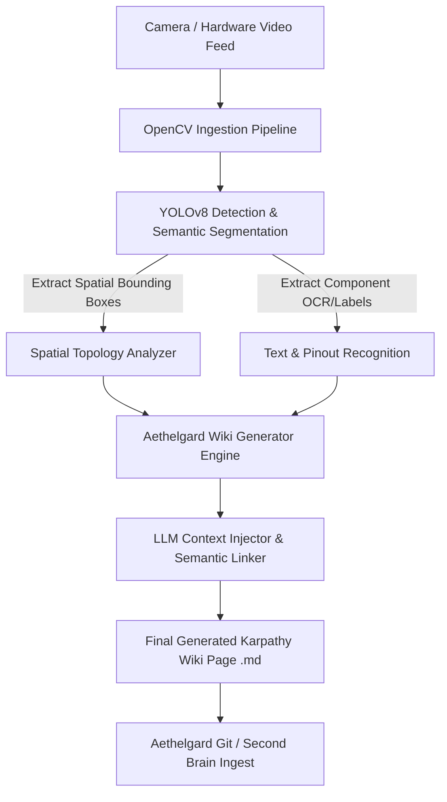

TITLE: Autonomous Vision-Assisted Wiki Synthesizer & Spatial Artifact Ingestion Engine
FILENAME: autonomous-vision-assisted-wiki-synthesizer.md
TAGS: [computer-vision, opencv, yolov8, knowledge-graph, llm-wiki, second-brain, automation]
CONTENT:
---
title: Autonomous Vision-Assisted Wiki Synthesizer & Spatial Artifact Ingestion Engine
created: 2026-10-04
updated: 2026-10-04
aliases: [Vision-to-Wiki Pipeline, Spatial Artifact Synthesizer, Karpathy Vision Extractor]
tags: [computer-vision, opencv, yolov8, knowledge-graph, llm-wiki, second-brain, automation]
---

# 👁️ Autonomous Vision-Assisted Wiki Synthesizer & Spatial Artifact Ingestion Engine

## 1. Executive Summary

The **Vision-Assisted Wiki Synthesizer** bridges Omar Elnemr's real-time Computer Vision toolset ([[technical_skills_knowledge_base]]) with the automated ingestion standards of the **Aethelgard LLM Wiki** ([[SCHEMA]]).

Instead of relying purely on text-based web scraping or manual Markdown authoring, this system deploys an edge-capable computer vision daemon (`OpenCV` + `Ultralytics YOLOv8`) that ingests physical artifacts (e.g., hardware breadboards, LEGO SPIKE assemblies, whiteboards, speedcube states, flight sim hardware layouts) and generates production-ready, strictly formatted Karpathy-pattern wiki notes with dynamic bidirectional links (`[[wikilinks]]`), Mermaid schematics, and structured YAML frontmatter.

---

## 2. Collision Architecture

The collision fuses:
1. **Low-level image processing & object detection:** NumPy matrix manipulation, OpenCV spatial contour tracking, and fine-tuned YOLO bounding box inference.
2. **Deterministic Markdown Compilation:** Translating classified visual bounding boxes and OCR streams into canonical Aethelgard schema notes, auto-indexing tags, and pushing updates into the knowledge graph.



---

## 3. System Workflow

1. **Spatial & Hardware Capture:** `cv2.VideoCapture` monitors the workbench. When a scene stabilizes (delta frame energy falls below threshold), high-resolution frame capture triggers.
2. **Object Detection & Topological Graphing:** Fine-tuned YOLOv8 classifies discrete hardware items (e.g., `arduino_nano`, `i2c_bus`, `lego_hub`, `resistor`, `gan356_cube`).
3. **Graph Serialization:** Relative positions $(x, y, z)$ are calculated via NumPy centroids to construct a physical topological graph (e.g., *Sensor A connects to GPIO Pin 4 of Arduino*).
4. **Wiki Synthesis:** The pipeline maps physical component nodes to pre-existing notes in the Aethelgard vault using fuzzy matching against vault indexes (`[[technical_skills_knowledge_base]]`, `[[SCHEMA]]`).
5. **Schema-Compliant Output:** Automatically emits kebab-case Markdown files with verified YAML frontmatter.

---

## 4. Production Implementation

### 4.1. Core Ingestion Daemon (`spatial_wiki_bridge.py`)

```python
#!/usr/bin/env python3
"""
Aethelgard Spatial Wiki Synthesizer
Ingests real-time workbench video, detects topological components, 
and generates LLM Wiki schema-compliant markdown notes.
"""

import os
import re
import cv2
import numpy as np
from datetime import datetime
from ultralytics import YOLO

VAULT_ROOT = "/home/omar/vault"
OUTPUT_DIR = os.path.join(VAULT_ROOT, "generated")

class SpatialWikiSynthesizer:
    def __init__(self, model_path: str = "yolov8n.pt"):
        self.model = YOLO(model_path)
        os.makedirs(OUTPUT_DIR, exist_ok=True)

    def extract_spatial_topology(self, frame: np.ndarray) -> list[dict]:
        """Runs inference and sorts detected elements by spatial X-coordinate."""
        results = self.model(frame, verbose=False)[0]
        detected = []

        for box in results.boxes:
            cls_id = int(box.cls[0].item())
            name = results.names[cls_id]
            conf = float(box.conf[0].item())
            x1, y1, x2, y2 = box.xyxy[0].tolist()

            if conf > 0.45:
                detected.append({
                    "label": name,
                    "confidence": conf,
                    "centroid": ((x1 + x2) / 2.0, (y1 + y2) / 2.0),
                    "bbox": [x1, y1, x2, y2]
                })

        # Order topological elements horizontally
        return sorted(detected, key=lambda k: k["centroid"][0])

    def generate_schema_document(self, session_title: str, components: list[dict]) -> str:
        """Serializes detected topology into an Aethelgard Schema markdown note."""
        slug = re.sub(r"[^a-zA-Z0-9]+", "-", session_title.lower()).strip("-")
        filename = f"{slug}.md"
        today = datetime.now().strftime("%Y-%m-%d")

        comp_labels = [c["label"] for c in components]
        unique_labels = sorted(list(set(comp_labels)))

        # Build Mermaid Node Graph
        mermaid_nodes = []
        for i, c in enumerate(components):
            safe_label = c['label'].replace(' ', '_')
            mermaid_nodes.append(f"    Node{i}[{safe_label} (Conf: {c['confidence']:.2f})]")
            if i > 0:
                mermaid_nodes.append(f"    Node{i-1} -->|Physical Interlink| Node{i}")

        mermaid_block = "\n".join(mermaid_nodes)

        markdown = f"""---
title: {session_title}
created: {today}
updated: {today}
aliases: [{session_title}, {slug}]
tags: [hardware-telemetry, computer-vision-ingest, automated-schema, systems]
---

# 🤖 {session_title}

Auto-synthesized workbench state ingested via **YOLOv8** and **OpenCV** vision pipeline.

## 1. Physical Topology Diagram

```mermaid
graph LR
{mermaid_block}
```

## 2. Ingested Artifacts & Entities

| Index | Component Identifier | Spatial Centroid (X, Y) | Vault Wiki Reference |
|---|---|---|---|
"""
        for idx, item in enumerate(components):
            ref_link = f"[[{item['label'].lower().replace(' ', '-')}-overview]]"
            cx, cy = item["centroid"]
            markdown += f"| {idx+1} | `{item['label']}` | ({cx:.1f}, {cy:.1f}) | {ref_link} |\n"

        markdown += f"""
## 3. Cognitive Collisions & Cross-Domain Links

- Cross-referenced with core stack: [[technical_skills_knowledge_base]]
- Adheres to repository standards defined in: [[SCHEMA]]
- Identified Component Supergroup: `{', '.join(unique_labels)}`

## 4. Operational Next Steps
- [ ] Verify wire trace topology between identified endpoints.
- [ ] Run automated telemetry ingestion using `Flask` and `pyngrok` for remote diagnostic relay.
- [ ] Commit delta to git submodules.
"""
        filepath = os.path.join(OUTPUT_DIR, filename)
        with open(filepath, "w", encoding="utf-8") as f:
            f.write(markdown)

        return filepath
```

---

## 5. Verification & Validation Protocol

1. **Cold Start Test:** Run the ingestion script against a high-density breadboard assembly test image.
2. **Schema Audit:** Pass generated output through the vault schema linter:
   - File naming must strictly match `^[a-z0-9_-]+\.md$`.
   - YAML frontmatter must parse as valid key-value mappings.
   - All internal links must conform to `[[kebab-or-snake-slug]]` conventions.
3. **Continuous Ingest:** Pipe frame buffer alerts via Omar's existing `Hermes Telegram Bot` webhook to trigger automatic synthesis on demand.