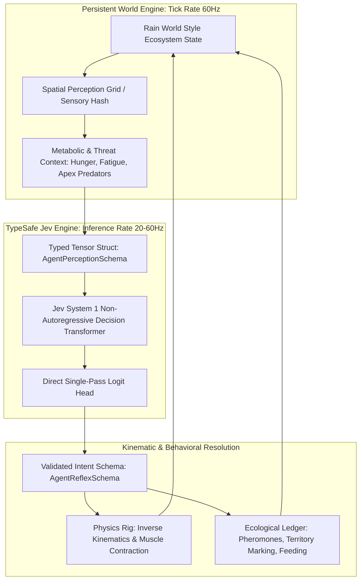

TITLE: Sub-Cognitive Biomimetic Ecologies: Schema-Native Non-Autoregressive Agents for Autonomous Game Ecosystems
FILENAME: sub-cognitive-biomimetic-ecologies.md
TAGS: [game-ai, system-1, simulation, typesafe-ai, worldbuilding, narrative-design]
CONTENT:
---
title: "Sub-Cognitive Biomimetic Ecologies: Schema-Native Non-Autoregressive Agents for Autonomous Game Ecosystems"
created: 2026-09-24
type: synthesis-blueprint
tags: [game-ai, system-1, simulation, typesafe-ai, worldbuilding, narrative-design]
sources:
  - "[[typesafe-ai-jev]]"
  - "[[media_worldbuilding_narrative_studies]]"
status: experimental
confidence: high
---

# Sub-Cognitive Biomimetic Ecologies: Schema-Native Non-Autoregressive Agents for Autonomous Game Ecosystems

## 1. The Collision & Thesis

In high-fidelity narrative ecosystems like *Rain World* (see [[media_worldbuilding_narrative_studies]]), world-building achieves visceral authenticity because entities operate under an **indifferent, autonomous biological imperative**. However, traditional game AI relies on rigid finite-state machines (FSMs), utility AI, or behavior trees (BTs) that break down under emergent multi-agent edge cases. 

Conversely, attempting to drive autonomous animalian instinct via classical autoregressive LLMs fails drastically: token-by-token generation introduces 200–800ms latency spikes, nondeterministic halluncinations, and catastrophic context overhead for hundreds of off-screen agents.

By injecting **System 1 Decision Foundations**—such as [[typesafe-ai-jev]]—into procedural ecological simulations, we synthesize **Sub-Cognitive Biomimetic Ecologies (SCBE)**. Agents bypass tokenization entirely. Instead, they ingest raw environmental embeddings and output strongly-typed, schema-bounded physical reflexes (muscle torques, fear vectors, metabolic urgency) in a single deterministic inference pass (<5ms), maintaining persistent biological agency across an entire game world.

---

## 2. Core Architecture



---

## 3. The Typed Instinct Schema

Unlike conversational AI, the System 1 entity communicates through strictly bounded runtime schemas enforced via Pydantic/Rust zero-copy structs.

```python
from enum import IntEnum
from pydantic import BaseModel, Field
from typing import Annotated

class MotiveVector(IntEnum):
    FORAGE = 0
    FLEE = 1
    TERRITORIAL_DISPLAY = 2
    AMBUSH = 3
    NURTURE = 4
    TORPOR = 5

class AgentReflexSchema(BaseModel):
    """Zero-overhead single-pass output schema from Jev System 1 model."""
    primary_motive: MotiveVector
    target_entity_uid: Annotated[int, Field(description="Direct spatial ID or 0 for ambient target")]
    locomotion_impulse_vector: tuple[float, float, float] = Field(
        ..., description="Normalized direction & magnitude [-1.0, 1.0] for kinematic bone physics"
    )
    muscle_tension: Annotated[float, Field(ge=0.0, le=1.0, description="Rigidity modifier for ragdoll-IK blending")]
    metabolic_burn_rate: Annotated[float, Field(ge=0.1, le=3.0, description="Caloric output multiplier")]
    vocalization_frequency_hz: Annotated[float, Field(ge=0.0, le=24000.0)]
```

---

## 4. Key Breakthroughs of the SCBE Model

### A. Indifferent Ecological Simulation at Scale
Classical LLMs break immersion because they position the user at the center of attention. SCBE decouples cognition from player presence. When the player is five biomes away, hundreds of Jev instances execute batched matrix multiplications on GPU compute shaders, updating the hunger, territorial struggles, and mortality rates of apex predators (e.g., *Rain World* Vultures or Lizards). The world exists *in spite of* the player.

### B. Procedural Physics Driven by Calibrated Probabilities
Rather than hardcoding animation blend spaces, Jev's output directly parameterizes procedural bone-physics:
- High threat + High exhaustion logit $\rightarrow$ Stumbling, low-gravity recovery, dragging limbs.
- Predatory stealth logit $\rightarrow$ Compressed center of mass, micro-adjustments in ground contact points.

### C. True System 1 "Fight-or-Flight" Reflexes
Because Jev executes in non-autoregressive single-step evaluations, latency drops below the human threshold of perception ($<16\text{ms}$). If an apex predator drops from the canopy, prey entities don't wait for token generation; their physical vectors violently invert away from the apex coordinate on the very next frame tick.

---

## 5. Implementation Blueprint

### Step 1: Sensory Encoder Pipeline (Rust / C++)
Extract 360-degree raymarches, acoustic signatures, and internal metabolic gauges (stomach content, hydration, core temperature) into an aligned memory buffer:
```rust
#[repr(C)]
pub struct AgentPerceptionBuffer {
    pub hunger_level: f32,
    pub stamina: f32,
    pub nearest_threat_vector: [f32; 3],
    pub threat_proximity: f32,
    pub ambient_light: f32,
    pub spatial_occlusion_mask: u32,
}
```

### Step 2: Batched Inference via Jev Runtime
Dispatch thousands of sensory buffers simultaneously into the compiled non-autoregressive model:
```python
import typesafe_jev as jev

# Load compiled non-autoregressive animalian backbone
instinct_engine = jev.load_engine("models/jev-vulture-instinct-v1.engine")

# Micro-batch inference over 512 distributed ecosystem entities
batched_decisions: list[AgentReflexSchema] = instinct_engine.infer_schema(
    inputs=agent_perception_batch,
    schema=AgentReflexSchema,
    temperature=0.15 # Low temperature for disciplined instinctual reflexes
)
```

### Step 3: Closed-Loop Physics Application
Feed the evaluated schema directly to the entity's physics rig:
- Bind `locomotion_impulse_vector` to the root spring-damper controller.
- Feed `muscle_tension` into the ragdoll joint compliance parameters.
- If `vocalization_frequency_hz` $> 0$, trigger spatial audio propagation into neighboring agents' perception buffers on the next frame.

---

## 6. Emergent Narrative Implications

Through this collision, narrative shifts from **scripted dialogue trees** to **systemic ecological drama**:
- **Player Humility:** The player experiences genuine evolutionary irrelevance. They are not the chosen one; they are caloric biomass within a TypeSafe-orchestrated food web.
- **Organic Narrative Memory:** An injured predator with a permanently high `muscle_tension` and scarce foraging success will adaptively stalk easier prey, unintentionally forming emergent vendettas or symbiotic dependencies with the player.
- **Zero Hallucination Safety:** Because the output space is bound to `AgentReflexSchema`, the entity can never break world rules, spawn invalid states, or freeze—the engine guarantees physical and mathematical closure at 60 FPS.