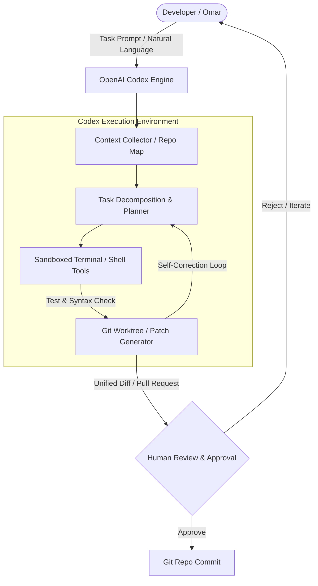
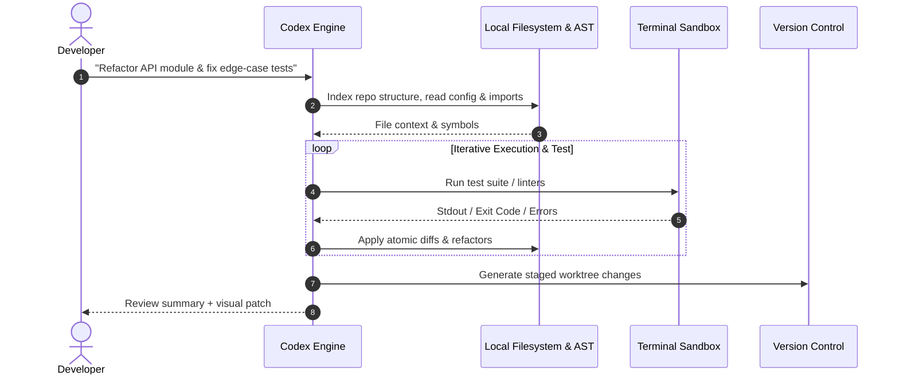
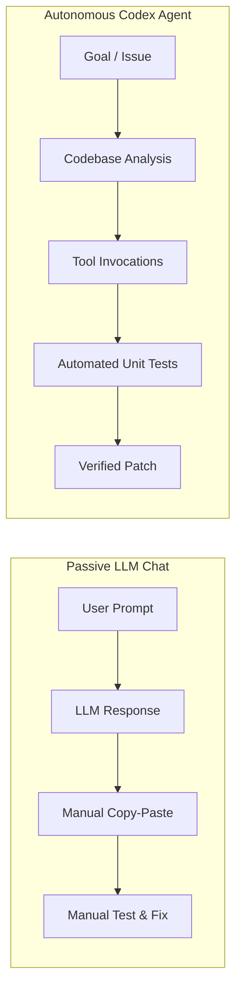

# OpenAI Codex CLI & Agentic Coding Architecture

## 🧭 Executive Overview
The **Codex CLI / Agent** workflow shifts development from simple chat assistance to autonomous, sandboxed terminal execution, tool use, and codebase refactoring. It bridges IDE context, terminal execution, and Git diff generation into a tight self-correcting feedback loop.

---

## 🏗️ Core Architecture & Execution Flow

---

## ⚡ Codex Operating Cycle

---

## 📊 Codex Agent vs Traditional Assistant

### Comparative Capabilities Matrix

| Dimension | Standard LLM Chat | OpenAI Codex CLI / Agent |
| :--- | :--- | :--- |
| **Context Window Utilization** | Single-turn / paste buffer | Entire repository mapping via tree-sitter & AST |
| **Execution Sandbox** | None (Static markdown code blocks) | Active PTY / Docker / native execution shell |
| **Verification Loop** | User manually runs tests | Agent auto-executes `pytest` / `npm test` & self-corrects |
| **Git Integration** | Manual staging | Branch creation, patch reviews, and commit messages |

---

## 🔗 Cross-Vault Connections
- [[01 Technical Skills]] — Core programming & agent toolchains
- [[concepts/unlazy-anti-laziness-agent-skill]] — Agent execution discipline & worktrees
- [[raw/articles/2026-11-21-learn-99-of-codex-in-one-video]] — Tech With Tim breakdown
