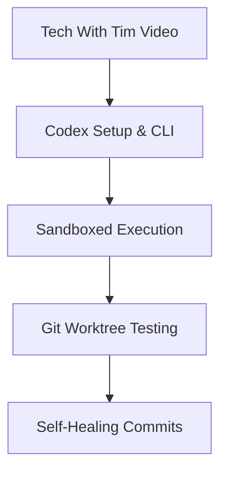

# Learn 99% of Codex in One Video

- **Platform:** `youtube_video`
- **Creator / Publisher:** Tech With Tim
- **Canonical URL:** [https://www.youtube.com/watch?v=oBvuhcdSsuw](https://www.youtube.com/watch?v=oBvuhcdSsuw)
- **Original Link:** `https://youtu.be/oBvuhcdSsuw?is=davgl6qIj_Jx6jJR`

## 📌 Summary & Content
Video breakdown by **Tech With Tim** covering practical OpenAI Codex workflows, CLI tool use, codebase indexing, and agent-driven autonomous software engineering.

### Architecture & Conceptual Deep Dive
See the dedicated concept note:
- [[concepts/openai-codex-cli-agentic-architecture]] (Includes Mermaid execution graphs and architecture diagrams)

---
*Ingested into [[index|Aethelgard Vault]] via Reel & URL Ingestion Pipeline.*
